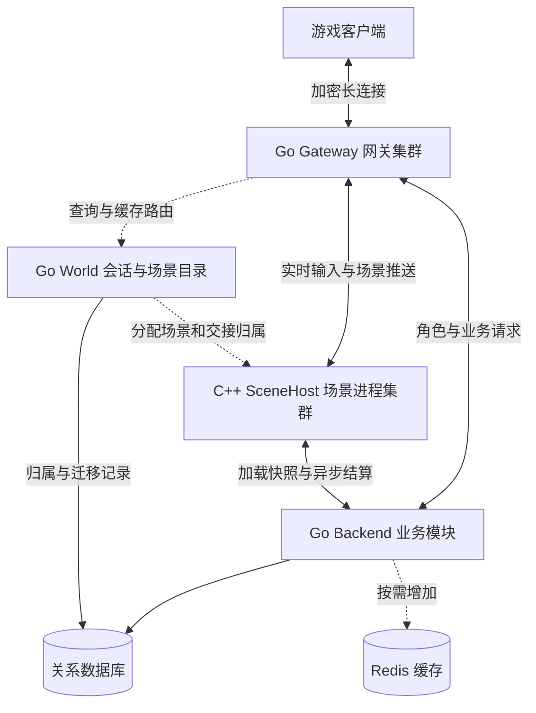

Go + C++ MMO 分布式服务器架构草案
================================

设计日期：2026-11-03。本文描述长期架构目标；已补充可运行 MVP，实际实现范围、启动方式和验证结果见 [README](README.md) 与 [部署文档](docs/DEPLOYMENT.md)。MVP 使用 HTTP/JSON、TCP 客户端和单实例 Backend，可选 SQLite / 指定 MySQL，尚未实现本文所有设计，也不代表生产容量承诺。

建议采用 Go 网关与业务层、C++ 场景模拟层，各自运行在独立进程中。扩容的基本单位是地图分线或副本实例。初版用少量进程验证状态归属、通信与故障恢复，再按实际瓶颈拆服务。

工作假设是实时 MMO、服务器权威判定、地图或副本之间允许显式传送。尚未确定的约束包括：客户端平台、动作强度、目标总在线数、单场景人数、同屏密度、团队规模，以及能否接受故障后的位置回退。无缝大世界、千人同屏和全球跨地域同步不作为本方案已经解决的能力。

**逻辑模块与部署进程分开设计。**



图中的 World 是逻辑模块，初版放在 Backend 内。网关查到路由后，移动、技能等高频输入直接送到对应 SceneHost；World 不参与每一次移动转发。

| 模块 | 建议语言 | 拥有的状态与职责 | 初版部署 |
| --- | --- | --- | --- |
| Gateway | Go | 长连接、绑定的会话、心跳、包长与速率限制、路由缓存、发送队列 | 独立进程，可运行多个 |
| Identity / Session | Go | 登录身份、短期登录票据、重复登录策略、会话代次 | Backend 内模块 |
| World / Directory | Go | 世界与场景实例目录、角色当前归属、节点容量、传送状态机 | Backend 内模块，单协调者 |
| Player / Economy | Go | 角色档案、背包、货币、装备配置、任务的持久进度、交易流水 | Backend 内模块 |
| Social | Go | 聊天、好友、公会、邮件等长期业务 | Backend 内模块，按负载拆出 |
| SceneHost | C++ | 多个场景实例；位置、速度、战斗 HP、技能冷却、AI、碰撞、AOI | 独立进程，可运行多个 |
| Persistence / Outbox | Go | 数据库访问、可靠结算、快照存取、待发送业务事件 | Backend 内组件及后台任务 |

Go 适合承担这里的网络并发和业务开发；C++ 用于需要细致控制数据布局、内存分配和计算成本的场景模拟。这是工程分工建议，不是性能结论。若玩法计算很轻，也没有需要复用的 C++ 模拟代码，应重新评估双语言的维护成本。

**跨语言边界优先放在进程之间。**

网关和场景分别部署，能够独立扩容、升级和隔离崩溃；代价是序列化、进程间通信以及两套构建工具链。第一版采用协议通信，不将整个有状态场景通过 cgo 嵌入网关。未来若要复用小型计算库，可以单独评估 cgo，但需遵守跨语言内存生命周期与指针规则。[Go cgo 官方说明](https://go.dev/cmd/cgo/)

**状态归属比语言划分更重要。**

| 数据 | 权威写入方 | 其他模块如何使用 |
| --- | --- | --- |
| 连接与发送队列 | 当前 Gateway | 断线后重建，不能依赖网关内存保存资产 |
| 当前会话与场景归属 | Session / World | 网关缓存，切换和重连时校验代次 |
| 场景内位置、HP、施法状态 | 当前 C++ 场景执行单元 | 客户端和其他服务接收副本 |
| 金币、背包、装备所有权 | Go Economy + 数据库事务 | 场景接收带版本的装备/属性快照 |
| 跨服排行榜 | 排行模块生成的派生视图 | 允许规定范围的更新延迟 |

同一份可变状态只有一个逻辑写入者。装备归属与当前战斗属性是不同状态：交易修改装备归属，场景在约定的 Tick 边界应用新版本属性。第一版可限制战斗中换装，避免半场战斗使用两个装备版本。

金币和背包不能一份在 Go、一份在 C++，再靠定时覆盖数据库来合并。网关也不是完全无状态：它拥有连接状态，只是不拥有角色的持久资产。

**场景内部采用单写者执行模型。**

```text
网络收包 → 校验消息信封 → 场景有界队列 → 场景执行单元
                                      ↓
                         消费输入 → AI/移动/战斗 → AOI差量
                                      ↓
                           异步发送与异步持久化请求
```

每个场景的可变对象只由自己的执行单元修改。网络线程不能直接修改实体；不同场景可以分配到多个线程，同一场景在同一时刻只有一个执行者。这不要求一个场景对应一个操作系统线程。

场景按固定时间步 Tick 推进。以 20 Hz 为纯示例，每步窗口为 50 ms；实际频率由玩法与压测决定，不是当前性能承诺。数据库查询、远程 RPC 和磁盘同步不应阻塞 Tick。寻路等任务可以读取不可变快照并行计算，结果返回时校验实体代次和输入版本，再由场景执行单元应用。

AOI（Area of Interest，兴趣区域）决定玩家需要接收哪些实体的更新。初版可采用空间网格做候选筛选，再按距离、视野或玩法规则过滤；进入、离开、变化分别发送。客户端提交移动和施法意图，服务器校验速度、冷却、目标和距离，并计算权威结果。

**通信分成外部连接、内部控制和实时数据三类。**

| 链路 | 初版建议 | 约束 |
| --- | --- | --- |
| 原生客户端 ↔ Gateway | TLS 上的 TCP 长连接 + Protobuf | 定义长度分帧、最大包长、心跳、认证和协议版本 |
| 浏览器客户端 ↔ Gateway | WebSocket over TLS + Protobuf | 按实际客户端需求选择，不必同时实现两种入口 |
| Go ↔ Go、Go ↔ C++ 控制请求 | Protobuf + gRPC 一元 RPC | 用于登录后业务、入场、查询、迁移和结算；明确截止时间 |
| Gateway ↔ C++ 实时通路 | 首版复用 gRPC 双向流，按节点和负载分组复用 | 批量收发；维护每角色序号、有界队列、重连与重同步 |
| 可靠后台事件 | 首版数据库 Outbox + 工作任务 | 需要独立吞吐和订阅者后再接消息中间件 |

Protobuf 是消息格式与接口定义方式，gRPC 是调用和传输框架，两者不是互斥选项。动作游戏对丢包和延迟有更严苛要求时，再依据公网网络实测评估 UDP/QUIC 等入口；可靠长连接并不适合所有玩法。

gRPC 支持双向流以及单个 RPC 内的消息顺序，但不提供断线重连后的业务连续性。长流建立后也不会自动重新分配到新节点，因此路由与重连仍由应用负责。[gRPC 核心概念](https://grpc.io/docs/what-is-grpc/core-concepts/) [gRPC 性能建议](https://grpc.io/docs/guides/performance/)

不要把一次移动拆成数个跨服务同步调用。实时通路只携带必要输入与更新，场景本地完成移动、碰撞、技能和 AOI 计算。多个角色复用流时，要设置每角色公平调度和队列上限，避免一个慢消费者拖住整条链路。

建议消息信封包括：协议版本、消息类型、角色 ID、会话代次、场景 ID、归属代次、输入序号；业务写操作另带稳定的 operation_id。角色 ID 与路由信息由已认证的网关绑定，不能直接相信客户端填写的值。

会话代次隔离旧连接；归属代次隔离旧场景；输入序号处理同一会话内的顺序；operation_id 标识一次业务操作，重试时必须保持不变。它们解决不同问题，不能全部替换成一个 request_id。

一元调用要设置并传播截止时间。流需要建立超时、心跳或空闲检测，以及断线后的会话恢复机制。RPC 超时不代表业务没有执行，客户端与服务端可能对成功与否得到不同结论；不能据此直接重复扣款或回滚已提交状态。[gRPC 截止时间](https://grpc.io/docs/guides/deadlines/) [gRPC 调用生命周期](https://grpc.io/docs/what-is-grpc/core-concepts/)

**流控还需要业务层的背压。**

所有收发队列按条数、字节和最长等待时间设置上限。持续堆积时限流、拒绝新请求或断开慢客户端。只有可被新状态完整替代的快照更新可以合并；差量、技能、交易、生成/销毁实体等消息不能随意丢弃。合并差量前应能重建基准，必要时发送新完整快照。

gRPC 的流控限制传输发送速度，并不替代业务队列上限；写入流成功也不意味着对端已收到或执行。因此场景 Tick 只投递有界发送队列，阻塞式网络写入放在其他执行单元。[gRPC 流控说明](https://grpc.io/docs/guides/flow-control/)

**三条调用链决定主要模块接口。**

登录入场：客户端连接 Gateway → Identity 验证票据 → Session 建立新会话代次 → World 选择场景 → Backend 加载角色和装备版本 → SceneHost 创建待激活角色 → 提交归属 → 核实已提交的归属并激活、返回初始快照。重新登录时旧会话失效；各业务入口也要校验会话，不能只在网关踢掉旧连接。

首次创建、迁移载入和快照恢复都经过同样的激活门槛：确认场景实例仍有效、角色归属代次匹配且迁移状态允许激活，才可处理输入、伤害其他实体或发出结算；核实失败时保持暂停。禁止仅凭一份旧快照恢复为活跃角色，因为即使旧角色自己的输出被网关拒收，它仍可能通过伤害其他角色间接产生副作用。

移动战斗：客户端输入 → Gateway 依据缓存路由转发 → C++ 校验代次和输入序号 → 场景 Tick 推进 → AOI 计算接收者 → 对应 Gateway 推送。这条链路通常不查询数据库；受持久资产影响的动作按下面的结算协议处理。

购买物品：客户端请求 → Gateway → Go Economy → 同一数据库事务内校验余额、扣款、发物品、记录 operation_id 和操作结果 → 提交 → 返回结果。响应丢失时查询或重试同一 operation_id，返回已记录结果。

**持久化按数据损失容忍度分别设计。**

首版选择一种关系数据库即可，本文以 PostgreSQL 为例。若团队已熟悉 MySQL，可保持同样的事务与所有权设计替换实现。Redis 作为可重建缓存按需引入。

货币、背包和交易需要在事务中使用条件更新或行锁保护不变量，并用唯一业务键去重。多角色交易在单库阶段尽量在同一事务完成；分库后必须重新设计托管、结算和恢复流程。仅有 Actor 串行队列并不能代替跨进程重试下的数据库约束。事务隔离级别需要结合查询与冲突模式选择，并处理冲突重试。[PostgreSQL 事务隔离文档](https://www.postgresql.org/docs/current/transaction-iso.html)

Outbox 指与业务状态在同一个数据库事务中记录待发布事件，提交后由后台任务投递。接收方仍需幂等处理，因为发送后、标记完成前的故障会导致重投。消息中间件是否存在，不改变这一点。

战斗奖励采用可恢复结算：场景生成稳定的奖励事件标识；在向玩家确认奖励前，由 Go 可靠保存结算事实并完成幂等入账。不能先在客户端显示已到账，再只把事件放进场景内存队列。事件标识与击杀/掉落领取状态应可从持久记录恢复，不能在场景重启后为同一次奖励生成全新的标识。

消耗持久物品后生效的技能需要同时处理“扣除成功”和“效果已经应用”两个事实。等待业务确认后施法仍可能在两步之间崩溃，导致扣了物品却没有效果。首版最小战斗使用不消耗持久资产的技能；这类道具技能上线前，需要持久记录待完成操作、稳定的效果标识，以及效果恢复或补偿规则。恢复时应能判定已生效、尚未生效或结果待核实；只有确认未生效才执行补偿，结果不明时先核查，不能直接重施技能或退款。若后续引入预留额度，还需定义预留的提交、释放和恢复语义。

位置、朝向等允许回退的数据可做周期快照，但必须定义可接受的回退窗口并监控实际持久化延迟；快照间隔本身不等于最大损失时间。需要精确恢复的状态要增加持久日志或其他恢复机制。快照带配置版本、场景 Tick、角色归属代次和已处理事件水位，恢复时与经济流水对账，避免重复奖励。

数据库提交的耐久性还取决于部署和故障切换策略；单机开发库不提供生产高可用承诺。备份、恢复演练和故障切换后的数据损失目标必须在上线前确定。

**跨场景传送是显式的所有权移交。**

World 保存 role_id → scene_id / host_id / owner_epoch，以及 transfer_id 对应的持久迁移记录。一次迁移建议按下列步骤执行：

1. 校验角色当前归属，用唯一 transfer_id 建立记录，目标场景预留接收容量。
2. 源场景在 Tick 边界冻结角色，记录最后输入序号并生成快照；处理完或明确携带尚未完成的资产操作，保存可恢复的交接状态。
3. 目标场景载入为待激活角色，回报 READY；此时不能接受输入或产生可见副作用。
4. World 在数据库事务中校验旧归属仍匹配，原子提交新归属、递增 owner_epoch，并将迁移标记为 COMMITTED。
5. Gateway 暂停该角色旧路由、安装新代次；目标确认已提交后激活，向客户端发送完整快照。旧场景只保留清理用的副本。
6. 所有步骤按 transfer_id 幂等重试，最后确认清理源角色。

归属提交是迁移的决定点。提交前，只有持久地确认迁移已取消、旧归属仍有效且目标未激活，源场景才能解除冻结；提交后必须继续完成目标激活，不能因为响应超时就恢复源角色。提交结果不明时查询迁移记录，暂停该角色等待判定。

owner_epoch 是隔离旧写入者的栅栏令牌（fencing token）。场景发起的资产提交与快照写入，需要在实际写入事务中锁定对应角色归属行、校验当前代次，并持锁直到提交；World 改变归属也竞争同一行锁，或采用具有等价串行化保证的机制。仅在事务内普通读取一次代次仍可能与归属变更交错。多角色操作按固定顺序获取相关锁。网关也要拒收与当前绑定不符的场景输出。对迁移前已经可靠受理的资产操作，应依据其持久记录完成或查询，不能因为之后代次变化而丢失已提交结果。

锁或租约过期本身不能阻止旧进程恢复后访问外部存储；接收端必须校验版本。这个问题也适用于以后引入 etcd 的情况。[etcd 关于分布式锁与版本校验的说明](https://etcd.io/docs/v3.5/learning/why/)

源进程失联后的故障接管，比正常传送更复杂。第一版先停止受影响会话，确认旧实例被终止或隔离，再递增代次、从可靠状态恢复并重新入场。要做到网络分区下自动接管，需要完善节点租约、输出隔离、路由撤销确认与恢复状态机；在这些机制验证前，不声明支持无停顿自动接管。旧进程可能继续计算，但其结果不能再成为外部可接受的权威写入。

**断线、故障和发布分别处理。**

| 场景 | 预期处理 |
| --- | --- |
| 客户端短暂断线 | 场景保留角色一段可配置时间；重连鉴权、校验当前归属、替换会话、发送快照 |
| Gateway 退出 | 连接会断；客户端连接其他网关，重新绑定仍在运行的场景角色 |
| Gateway 与 SceneHost 流中断 | 重建流并重同步；按消息语义重试，不能无条件重放旧移动输入 |
| SceneHost 崩溃 | 受影响场景暂停，执行有边界的恢复；无日志的内存进度可能回退 |
| World 暂时不可用 | 暂停入场、传送和归属接管；既有场景是否继续受有效所有权和隔离机制约束 |
| 数据库不可用 | 暂停需要可靠提交的资产操作；已有场景只能在允许的未持久化预算内运行 |
| 计划升级 | 停止分配新场景，排空副本或进行受控迁移；协议兼容窗口内逐批替换 |

**扩容按三种人数分别规划。**

全服同时在线人数决定连接节点与场景总量；单场景人数影响一个场景的 Tick 负载；AOI 内互相可见的实体密度决定广播放大。这三者不能用一个“支持万人在线”来代替。

| 层次 | 主要扩容方法 | 容易误判的限制 |
| --- | --- | --- |
| Gateway | 增加实例，分配新连接，逐步排空旧实例 | 既有长连接不会自动迁移；带宽与慢客户端可能先成为瓶颈 |
| Go Backend | 先优化热点，再拆独立业务或按角色分片 | World 不得随业务副本复制出多个无协调的写入者；数据库可能更早饱和 |
| C++ SceneHost | 增加进程，把新地图分线和副本放到空闲节点 | 加机器不自动减少现有单场景的计算量 |
| 单场景热点 | 优化 AI、AOI、差量与批量广播，设计分线/副本和容量上限 | 同一密集战场的跨实体交互无法简单平均分配给任意节点 |
| 数据库 | 索引与事务优化、合适的缓存、只读派生视图，再评估分片 | 强一致读和资产结算不能随意移到有复制延迟的只读副本 |

初版调度器依据场景数量、Tick 高分位耗时、实体数、内存和出站带宽分配新场景。保留容量余量，缩容先排空；新节点加入不会自动搬走正在运行的场景。

若 Backend 要多副本部署，先把 World 提成单独协调服务，或者实现可验证的选主与代次隔离。角色业务可按 role_id 路由到串行执行单元，但迁移、重试和跨角色操作仍需数据库事务约束。

无缝大世界的空间分区属于进一步演进：每个实体要有唯一归属，邻区维护只读影子，穿越边界时迁移，跨区技能和碰撞需要一致的时序规则。空间格子可以优化查询，却不会自动解决跨机器模拟。

**容量结论必须从明确的负载模型得出。**

模拟频率为 F Hz 时，Tick 窗口为 1000/F ms。观察 p95/p99 执行耗时与排队延迟，并给突发战斗和系统调度保留余量。多场景共用线程时，还要衡量调度等待，不能只看单次执行时间。

平均广播有效载荷可粗估为 N × k × f × s 字节/秒，其中 N 为产生更新的实体数，k 为每次更新的平均接收人数，f 为每实体每秒更新次数，s 为每次投递的平均有效字节数。还需加协议开销、进入离开消息和重传成本，批量与差量可能降低开销。这是规划公式，不是基准测试结果。

例如仅作算术演示：1,000 个实体、平均 30 个接收者、10 次/秒、40 字节/次，得到约 12 MB/s 有效载荷。若所有实体彼此可见，接收关系可能接近 N(N−1)，不能继续沿用固定 k 的容量假设。

| 观测位置 | 需要记录的指标 |
| --- | --- |
| 网关 | 连接数、消息率、出站带宽、每连接内存、发送队列字节数与等待时间 |
| 场景 | Tick 执行与调度等待的 p95/p99、输入积压、AI/寻路/AOI 分项耗时、实体数 |
| 业务 | 各操作吞吐和延迟、重试与超时率、幂等命中、待完成结算数量 |
| 数据库 | 事务延迟、锁等待、连接池等待、慢查询、快照和 Outbox 积压 |
| 玩家链路 | 输入至权威结果延迟、重连耗时、传送耗时、恢复耗时及状态回退范围 |

日志应能按 role_id、session_epoch、owner_epoch、transfer_id 和 operation_id 关联。指标标签使用有限维度，避免将每个玩家 ID 都作为指标标签。

**实施分成可验收的阶段。**

第一阶段在本机运行三类应用进程：一个 Go Gateway、一个 Go Backend、两个 C++ SceneHost，再加关系数据库。先实现登录、两个场景、移动与 AOI、最小战斗、一次幂等奖励、传送、保存与重连。两个 SceneHost 是为了实际验证进程间归属转移，不代表生产容量配置。

第二阶段把网关和场景放到多台机器，验证直达路由、连接重建、单协调者、场景排空和有限故障恢复。此时仍可使用静态服务地址，先把故障行为验证清楚。

第三阶段分别压测均匀分布、热点聚集、集中登录/重连、密集战斗、慢客户端和数据库变慢。容量报告必须同时记录硬件、玩法脚本、实体数、AOI 密度、Tick 频率、延迟分布及带宽。

第四阶段按证据引入独立 World、业务拆分、服务发现、消息中间件、自动调度和更强恢复机制。Redis、etcd、Kubernetes 都有适用价值，但不是首个闭环的必需条件。

建议将下列故障测试作为功能验收的一部分：

- 重复购买、重复奖励，以及提交成功但响应丢失：一次业务操作只产生一次资产变化。
- 传送各阶段杀掉源、目标或协调者：恢复后归属可判定，角色不会在两个场景同时产生有效副作用。
- 旧会话重连、旧代次保存、旧场景恢复：外部接收端拒绝已经失效的写入和输出。
- 网关重启：角色资产不依赖网关内存，能在规定时间内重新绑定。
- 数据库变慢和客户端停止读取：队列保持有界，Tick 不被同步 I/O 阻塞。
- 场景恢复到旧快照：已确认奖励不重复、资产消耗不凭空撤销，回退范围符合约定。

**当前需要保留的设计取舍。**

双语言增加协议演进、排障与构建成本；只有真实的模拟需求或 C++ 复用价值才能抵消这部分成本。单写者场景降低并发复杂度，同时形成单场景计算上限。周期快照降低存储成本，同时允许部分实时进度回退。关系数据库简化资产一致性，同时可能成为需要后续治理的集中瓶颈。

最早可能导致返工的三类问题是：Go 与 C++ 重复拥有资产、把全服容量误当作单场景容量、把 RPC 超时或租约过期当成安全回滚依据。本文的状态表、容量维度和迁移决定点分别用于提前约束这些风险。

这份设计尚未给出承载人数、恢复时长或延迟保证。下一步实现应首先固定三项产品约束：战斗节奏与 Tick 目标、单场景及同屏规模、不同数据允许的故障损失范围，再将它们转成可执行验收指标。
