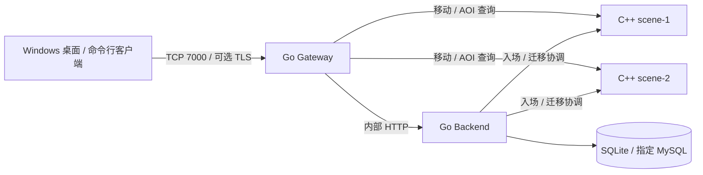

# Go + C++ MMO 分布式服务器 MVP

一个可分别部署的服务端原型：Go 网关承接玩家长连接，Go Backend 管理账号、场景归属和持久化，两个独立 C++ SceneHost 推进实时移动和 AOI。Linux Docker 是部署目标；同机 Compose 用于演示，多机模板位于 `deploy/`。

公开仓库：[dravenlove/mmo-server](https://github.com/dravenlove/mmo-server)。

**战斗版本的玩法与两台 VPS 更新步骤见 [COMBAT.md](docs/COMBAT.md)，数值热更和在线回滚见 [配置热更 demo](docs/CONFIG_HOT_RELOAD.md)。Windows 测试已部署的服务器，优先使用 [桌面客户端](docs/DESKTOP_CLIENT.md)。** 构建后双击 `dist/desktop/MMO.Client.exe`，填写 gateway 地址，即可测试连接、登录、移动、战斗和切换场景；本机直接连接远程服务器。

**两台 VPS 部署从这里开始：[统一部署流程：gateway + scene + MySQL](docs/DEPLOYMENT_TWO_HOSTS.md)。** 依次完成配置、拉取现成镜像、启动与验收；VPS 不需要编译 Go/C++。同一份文档也包含后续更新、停机、恢复和排错。

| 主机角色 | 建议配置 | 运行内容 |
| --- | --- | --- |
| `gateway` | Ubuntu 24.04.4 LTS，2GB 内存 | Go Gateway + Go Backend，连接指定 MySQL |
| `scene` | OpenCloudOS 9.6，4GB 内存 | 两个 C++ 场景容器 |

已有旧命名部署按主指南中的迁移入口处理，继续保留原密钥与数据。[镜像发布](docs/REGISTRY_DEPLOYMENT.md)、[离线打包](docs/PREBUILT_IMAGES.md)和[MySQL 参数](docs/MYSQL.md)是按需查阅的补充。



现有玩法包括注册登录、权威移动、邻近玩家视图、场景切换、断线重连与一次性欢迎奖励，并新增 [PvE 战斗试炼场](docs/COMBAT.md)：四个近战技能、怪物追击反击、血蓝和冷却、死亡复活，以及重连/跨场景战斗快照。两个场景是独立进程，可以放在不同机器。

**这不是完整 MMO 产品。** 当前实现采用 HTTP/JSON、网关轮询场景视图和单实例 Backend（可选 SQLite / MySQL）；包含基础 PvE 怪物和技能，但尚无装备等级任务、跨区无缝世界、自动场景故障迁移及生产账号系统。详细约束见 [协议](docs/PROTOCOL.md)；长期目标与当前 MVP 应分开阅读，见 [架构设计](ARCHITECTURE.md)。

## Windows 桌面客户端

已有客户端时直接双击 `dist/desktop/MMO.Client.exe`，先点“测试连接”，再用新角色名“连接并登录”。测试连接只发送游戏协议 ping，不创建账号。

从源码构建需要 .NET 10 SDK。在 Windows 项目根目录的 PowerShell 中执行；下例用于已经配置 TLS 的网关，域名须替换为自己的：

```powershell
.\scripts\build-desktop.ps1 -Address 'game.example.com:7000' -Tls -Shortcut
```

当前开发机已有 .NET 10 Desktop Runtime，可以双击运行默认发布的 exe。交付给没有该运行时的 Windows x64 电脑时，构建参数追加 `-SelfContained`。客户端连接远程 gateway 时，本机无需启动服务端或安装 Docker/Go；后文的 Docker 同机演示与 Go 命令行客户端各有自己的环境要求。TLS 开关须与网关配置一致，使用和凭据说明见 [DESKTOP_CLIENT.md](docs/DESKTOP_CLIENT.md)。

## 本机启动

本节会在**同一台机器**上构建并运行全部四个服务。Ubuntu + OpenCloudOS 两台 VPS 部署时，直接使用 [两机部署文档](docs/DEPLOYMENT_TWO_HOSTS.md) 的 `gateway`/`scene` 配置；VPS 按角色拉取已发布镜像并启动，不执行本节的构建命令。

以下命令使用 Linux shell，要求 Docker Engine 运行中、支持 `docker compose`，并能拉取镜像、系统软件包和 Go 依赖。C++ 第三方头文件已随源码提供，构建场景时不再下载第三方源码。

```bash
cp .env.example .env
openssl rand -hex 32
```

把生成的随机值填入 `.env` 的 `INTERNAL_TOKEN=` 后；至少 32 字符，各服务使用同一个值。不要使用示例字符串。然后运行：

```bash
chmod 600 .env
docker compose config --quiet
docker compose up -d --build --wait
docker compose ps
```

默认端口全部绑定 `127.0.0.1`，用于本机演示：玩家入口 `7000`，网关健康检查 `8080`，Backend `8081`，场景 `9001` 与 `9002`。默认明文只适用于本机或可信私网；公网部署配置入口 TLS，参见 [部署说明](docs/DEPLOYMENT.md)。

```bash
curl --fail http://127.0.0.1:8080/healthz
curl --fail http://127.0.0.1:8081/healthz
curl --fail http://127.0.0.1:9001/healthz
curl --fail http://127.0.0.1:9002/healthz
docker compose logs --tail 100
```

健康检查通过表示相应进程可响应；它不替代注册、移动、切换与重连的端到端验证。

## 连接客户端

Windows 图形界面优先使用上面的桌面客户端；以下为开发或自动化联调用的 Go 命令行客户端。

宿主机有 Go 时，从项目根目录运行：

```bash
mkdir -p tokens
chmod 700 tokens
go run ./cmd/client -addr 127.0.0.1:7000 -name alice -token-file ./tokens/alice.token
```

客户端在注册前先预留凭据文件，确认路径可写，再保存服务端返回的登录 token；Linux 文件权限为 `0600`。已有有效凭据文件时读取 token 登录，不再次注册。请保管此文件，它相当于本演示的登录凭据。第二个终端使用不同名字和 token 文件可观察 AOI；追加 `-watch` 可打印连续状态推送。

交互命令：

```text
move 1 0
view
transfer scene-2
claim
claim
quit
```

移动是方向输入：场景以固定 Tick 按速度推进，250ms 没有新输入就停止。单次 `move` 不是瞬移或持续无限移动。第一次 `claim` 领取 100 金币，重复领取不再次加钱。`-scene scene-2` 可用于选择登录后进入的目标场景；`-script commands.jsonl` 从 JSONL 文件执行协议命令。命令字段见 [协议](docs/PROTOCOL.md)，例如：

```jsonl
{"op":"view"}
{"op":"move","seq":1,"dx":1,"dy":0}
{"op":"sleep","ms":300}
{"op":"view"}
{"op":"transfer","target_scene_id":"scene-2","request_id":"alice-demo-transfer-001"}
{"op":"claim"}
{"op":"claim"}
```

`sleep` 是客户端脚本本地等待，不发送给服务器；其余字段见协议。同一角色的一次迁移应复用同一 `request_id` 重试；新迁移使用新 ID。交互命令支持 `transfer scene-2 [request_id]`：省略 ID 时客户端会生成并输出它，遇到超时可用 `transfer scene-2 刚才输出的ID` 重试。不要为同一 token 同时开启多个客户端，会话代次更新会使旧连接失效。

也可将客户端构建为容器。下面的 `--network host` 示例适用于 Linux Docker，token 保存在单独的命名卷里：

```bash
docker build -f Dockerfile.golang --build-arg SERVICE=client -t mmo/client:dev .
docker run --rm -it --network host \
  --mount type=volume,source=mmo-client-tokens,target=/app/tokens \
  mmo/client:dev -addr 127.0.0.1:7000 -name alice -token-file /app/tokens/alice.token
```

## 分别部署与持久化

两台 Linux VPS 使用 [统一部署流程](docs/DEPLOYMENT_TWO_HOSTS.md)：**`gateway` 运行 Gateway 与 Backend、连接指定 MySQL；`scene` 运行两个 C++ 场景**。对应配置为 `deploy/gateway-host.compose.yaml` 与 `deploy/scene-host.compose.yaml`，各自配一份实际 env 文件。

当前两台 VPS 的建议分配为 **`gateway` = Ubuntu 24.04.4 LTS，`scene` = OpenCloudOS 9.6**。应用镜像由 GitHub Actions 或开发机构建，VPS 只负责拉取和运行；两个系统的 Docker 安装方式见 [系统准备](docs/GITHUB_VPS.md#2-安装-docker)。

`deploy/backend.compose.yaml`、`deploy/scene.compose.yaml`、`deploy/gateway.compose.yaml` 可分别在不同 Linux 主机启动。两台场景机共用场景模板，使用不同的 `SCENE_ID`、地址与端口；Backend 的 `SCENES` 必须填写网关和 Backend 都能访问的真实私网地址。跨主机不能使用本机 Compose 的 `backend`、`scene1` 等容器名。

需要将每个服务拆到独立主机时，另看 [通用部署与 TLS 补充](docs/DEPLOYMENT.md)。本节下面不带 `-f` 的 `docker compose` 命令用于根目录同机演示，VPS 的角色命令以统一部署流程为准。

需要连接指定的 MySQL 时，配置 `BACKEND_DB_DRIVER=mysql` 和 `MYSQL_HOST`、`MYSQL_PORT`、`MYSQL_USER`、`MYSQL_PASSWORD`、`MYSQL_DATABASE`，详见 [MySQL 配置与切换](docs/MYSQL.md)。修改地址无需重编镜像；本机还可用 `-mysql-host`、`-mysql-port` 参数覆盖环境变量。

默认 SQLite 数据位于 Backend 的 `/app/data`，本机命名卷是 `mmo-demo-backend-data`。**两种数据库模式都只运行一个 Backend，不要执行副本扩容。** SQLite 文件锁和 MySQL 会话锁防止同一库被多个 Backend 同时打开，不能替代数据库高可用。

```bash
docker compose stop gateway
docker compose stop backend
docker compose stop scene1 scene2
docker compose up -d --wait
```

正常重启保留命名卷。场景重启会丢失内存实时状态，客户端需要重新登录并从最近位置快照恢复；已提交金币仍保留。`docker compose down` 保留命名卷，`docker compose down -v` 会删除它，切勿把后者用于日常停止服务。

每个场景最多保留 **128 个已加载角色**，包括离线、冻结和待激活角色，当前没有离线自动回收。这不是“128 人同时在线”的性能承诺。每实例还限制 8192 个历史角色身份隔离记录，每角色每会话最多保留 256 条取消迁移记录；超限拒绝相应新操作。后者可在完成未决迁移后重新登录刷新会话，前两类容量需要受控释放或重启，详见 [部署边界](docs/DEPLOYMENT.md#8-故障排查与当前边界)。重启会丢失内存墓碑和未保存位置，不能作为无损扩容手段。

## 本机开发验证

Windows 本机断点调试见 [LOCAL_DEBUG.md](docs/LOCAL_DEBUG.md)：已提供 VS Code 四进程启动配置、Debug 构建和独立的调试数据目录。准备一次后选择 `MMO: all services (Windows)` 按 F5，即可在 Go 与 C++ 代码中设置断点。

Windows 需要 Go、CMake、Visual Studio 2022 的 C++ 编译工具和 Python 3。在项目根目录的 PowerShell 中执行：

```powershell
./scripts/build.ps1
go test ./...
go vet ./...
ctest --test-dir build/scene -C Release --output-on-failure
python scripts/smoke.py
```

构建结果位于 `bin/`。`smoke.py` 启动网关、Backend 和两个场景的独立进程，验证跨进程通信与持久化流程；它使用 Python 标准库，不要求 Docker。

Linux 开发环境准备好 Go、CMake、C++17 编译器和 Python 3 后可执行：

```bash
sh scripts/build.sh
go test ./...
go vet ./...
ctest --test-dir build/scene -C Release --output-on-failure
python3 scripts/smoke.py
```

这些是原生开发检查命令。Docker 容器验证仍需按前面的 Compose 启动和客户端流程进行。

## 验证边界

Windows 原生四进程端到端 smoke 已通过 15/15 项，Go 测试与静态检查通过，C++ CTest 通过 2/2 项；TLS 入口通过可信证书与不可信证书测试。三个 Go 程序也已完成 Linux amd64 交叉编译。详细范围见 [验证记录](docs/VALIDATION.md)。

本机 Docker Desktop 已完成四个 `linux/amd64` 镜像的构建、`gateway`/`scene` 两包导出和重新加载，包含 C++ 的 Linux 编译。隔离环境的 Docker 端到端验证通过 8/8 项，覆盖登录、移动、奖励、跨场景迁移、CLI 凭据卷和全部容器重启后的持久化恢复。七份 Compose 配置展开通过（包含两机 `gateway`/`scene` 配置）；两台真实 VPS 的私网联通、云防火墙、实际 TLS 证书挂载与容量仍需现场验收。

运行 `python scripts/package.py` 可生成 `dist/mmo-mvp-source.zip` 与 SHA-256 校验文件。源码包只包含明确列出的源码、依赖、测试和部署资料，不含数据库、实际环境变量文件、玩家凭据、编译产物及测试日志。
