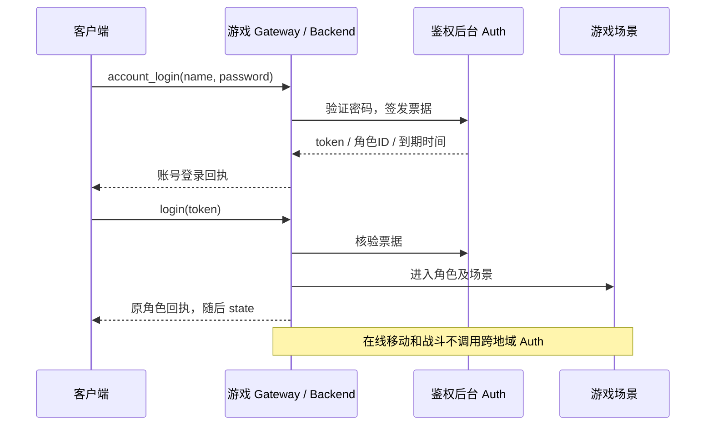

# 简单账号密码登录 v1

本版增加服务端账号密码注册、登录、旧账号绑定密码，不修改 Unity 客户端。账号和角色暂为一对一，账号名就是原角色名。移动、战斗和自定义技能仍使用已有协议。

## 入口与顺序

沿用所需玩法的 WSS：移动 `/ws`、核心战斗 `/combat/ws`、元素试炼 `/elemental/ws`、参数化技能 `/skills/ws`。例如 `wss://203.0.113.10/skills/ws`，其中 IP 是占位地址。

保持证书校验和精确网页 Origin 白名单。密码和 token 放 JSON 消息体，不放 URL、查询串、日志或聊天记录。公网密码调用必须走 WSS 或配置 TLS 的原生入口；明文 TCP 只用于本机受控测试。



打开 WSS 不创建账号。先按用户选择执行注册或账号登录，收到 token 后再发送原 `login`。`account_*` 仅允许在连接尚未进入游戏时调用；已进入游戏时需先关闭连接、重新建立 WSS。

## 注册与登录

新账号注册：

```json
{"id":"register-1","op":"account_register","name":"player_demo","password":"replace-with-your-own-password"}
```

```json
{"id":"register-1","op":"account_register","ok":true,"data":{"role_id":"32位角色ID","name":"player_demo","token":"64位随机token","expires_at_unix_ms":1794614400000}}
```

已有密码账号登录：

```json
{"id":"account-login-1","op":"account_login","name":"player_demo","password":"replace-with-your-own-password"}
```

成功 `data` 与注册相同，每次生成新 token。账号不存在、密码错误、旧账号未绑定密码，统一返回登录失败。用户名已注册返回 `ok:false,status:409`，应登录或更换账号名，不能重复注册覆盖。

用户名区分大小写，1～24 个 Unicode 字符，无控制字符和首尾空白。密码为 8～72 个 UTF-8 **字节**，无控制字符，不自动 trim；中文通常占多个字节。数据库只存 bcrypt cost=10 的加盐哈希，不存明文密码。

取得 token 后，同一连接发送：

```json
{"id":"enter-1","op":"login","token":"上一步收到的token"}
```

回执仍是原角色对象，之后继续原 `view/move/skill_init/cast`。账号密码不随动作重复发送。`account_login` 本身不进入场景、不改变游戏 session；原 `login` 才建立新游戏会话并使旧会话失效。

注册先保存鉴权记录，游戏角色在首次 `login` 时幂等创建。若进入游戏失败，保留 token 重试，或用账号密码重新取得 token。注册响应丢失时可以用同一账号密码登录，不重新注册。

## 旧账号绑定密码

新连接上从原私有凭据文件读取 token，执行一次绑定：

```json
{"id":"bind-1","op":"account_bind","token":"已有账号的原token","password":"replace-with-your-own-password"}
```

```json
{"id":"bind-1","op":"account_bind","ok":true,"data":{"bound":true,"role_id":"原角色ID","name":"原角色名"}}
```

角色、金币、战斗数据和旧 token 均保留。绑定只能进行一次，已有密码返回 409，不能用此接口改密。原 `register(name)` / `login(token)` 继续兼容；旧 `register` 是 token 演示注册，不是密码注册。向旧操作传非空 `password` 会明确拒绝，防止误以为已设置密码。

## 票据、限流与错误

- 新票据有效 24 小时，数据库只保存 SHA-256 哈希，Auth 重启后仍有效。
- 每账号最多保留 5 张有效新票据，签发第 6 张时淘汰最早票据；原长期 token 不变。
- 过期/淘汰票据不能用于新的 `login`，不会主动踢掉已进入场景的会话。退出关闭 WSS，按原流程保存权威状态。本版不提供主动撤销票据。
- 注册、密码登录、绑定共享每分钟 60 次；同账号名每分钟 6 次，绑定按提交 token 的哈希计数。最多同时进行 2 个密码运算，超出直接 429，不无限排队。固定窗口限流在 Auth 重启时重置，只适合当前小规模联调。
- `status:400` 格式无效；`401` 凭据错误/过期；`409` 账号名或密码绑定已存在；`429` 请求太多或密码运算繁忙；`503` Auth/数据库暂不可用。客户端按 status 处理账号失败，不依赖错误文案；并非所有旧游戏错误都带 status。
- 按 `id` 匹配回执并处理穿插的 `state`。客户端不保存密码；token 优先放内存或平台安全存储，不打印完整回执。

## 数据与部署

Auth 继续运行在鉴权后台主机；Game Backend 经既有加密链路访问它。内部 `/v1/account_register`、`/v1/account_login`、`/v1/account_bind` 必须带 `X-Internal-Token`，不直接暴露公网。

仅新增 `auth_passwords`、`auth_login_tokens` 两表。原 `auth_accounts`、`roles`、`combat_snapshots` 和长期 token 不变。新密码账号分配一份不下发的稳定兼容哈希，角色初始化用同一哈希，防止临时 token 轮换导致 Auth 重启导入冲突。账号、密码及首张票据在一个事务注册，MySQL 使用 InnoDB。

更新 Auth、Game Backend、五个 Gateway；C++ Scene 和 WSS bridge 无需更新。游戏主机设置 `MMO_BACKEND_IMAGE_TAG`、`MMO_GATEWAY_IMAGE_TAG` 为新标签，保留 `MMO_IMAGE_TAG`、`MMO_SKILL_LAB_IMAGE_TAG`，避免重启场景。鉴权主机的 `MMO_IMAGE_TAG` 更新为同一新标签。先备份数据库和配置，再依次更新 Auth、Backend、Gateway；核对旧身份、余额、快照和未完成迁移。

回退旧镜像时新密码账号和票据暂不可用，新增表保留；不能用旧数据库覆盖上线后的数据。完整拓扑见 [游戏与鉴权部署](GAME_AUTH_DEPLOYMENT.md)，玩法见 [参数化技能协议](SKILL_LAB_HANDOFF.md)。本版不含邮箱、短信、改密找回、多角色和生产风控。
