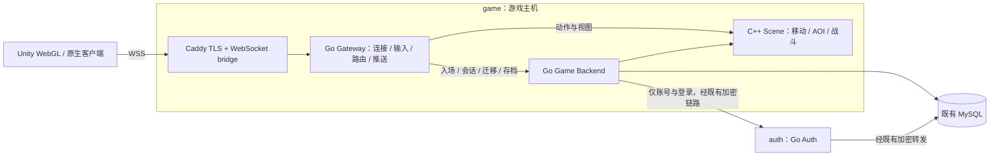

# 项目协作记忆与接手入口

维护日期：2026-11-13，Asia/Shanghai。运行快照于当日 10:48 只读复查；整理开始前源码/文档提交为 `9fed850466b31525c4ea4abeaa990c03a8f98174`。此后文档提交不代表容器已经重新构建。

本文件供接手 agent、客户端负责人、验证及部署负责人共享项目事实。它集中记录架构、代码入口、协议约定、版本、验证和交接流程；具体消息格式以对应协议文档和当前源码为准。仓库当前代码、当次运行检查和用户最新要求优先于历史快照。

## 1. 接手顺序

1. 阅读根目录 [AGENTS.md](../AGENTS.md)，检查 `git status --short`、分支、最近提交和正在进行的工作。
2. 从本文件找到模块入口，再读对应协议及实现。出现差异时先标记并核实，不根据旧版本号直接回退线上。
3. 明确本次任务目标、验收条件、允许修改的文件和跨模块影响；继承当前会话已明确的授权，不靠历史日志推断新授权。
4. 实现并运行与改动对应的验证。需要部署时先确认主机职责、实际 env、镜像标签及备份，再更新必要服务。
5. 交接时记录修改、提交、接口兼容性、验证范围、运行版本和剩余事项，并更新本文件及相关协议。不要把尚未完成的客户端工作写成已交付。

公开仓库：[dravenlove/mmo-server](https://github.com/dravenlove/mmo-server)。本机实际部署地址、SSH 入口、受控凭据**路径**和探针位置另见本机忽略目录 `output/AGENT_OPERATIONS_20261113.md`；该文件不随 clone 分发。缺少该文件时，代码工作仍可使用本文，部署则读取当前机器已有的私有配置，不索取聊天中的密码或私钥。

## 2. 已确定的职责和拓扑



- game：Ubuntu 24.04.4 LTS、x86_64、2 核、约 4GB；运行 5 个 Gateway、1 个 Backend、6 个 C++ 场景，共 12 个游戏容器，以及宿主机上的 Caddy/bridge。
- auth：OpenCloudOS 9.6、x86_64、2 核、约 2GB；只运行账号 Auth，不承担每次移动或技能结算。
- 两台主机跨地域。曾发生腾讯云免费跨地域带宽不足，已有加密链路和数据库转发；不要把实时战斗重新放回跨地域 Auth 调用链。
- 后台鉴权不是网页 GM 后台，当前没有支付、封禁平台或完整运营后台。
- Game Backend 和 Auth 各自是单写入者，MySQL 使用不同命名锁。不能直接扩容两个同角色写入实例连接同一业务库。

拓扑与 Compose 说明：[GAME_AUTH_DEPLOYMENT.md](GAME_AUTH_DEPLOYMENT.md)。该文早期版本号只作历史背景，镜像选择以下表及最新验证记录为准。`gateway-host` / `scene-host` / `two-host-*` 是历史部署，不是当前目标拓扑。

## 3. 已验证运行版本

以下是 2026-11-13 10:48 的快照，不是未来自动保持的目标状态。镜像前缀为 `ghcr.io/dravenlove/mmo-server`。

| 组件 | 镜像 / 标签 | 镜像源码 revision |
| --- | --- | --- |
| game Backend | `backend:account-20261113-v1` | `674a5502f18671434f1162afa86a448990517510` |
| game 五个 Gateway | `gateway:account-20261113-v1` | `674a5502f18671434f1162afa86a448990517510` |
| auth Auth | `backend:account-auth-20261113-v2`，命令 `-role auth` | `4ab0058a478b4c6a66f707b6a66acde7eda0a615` |
| `scene-skills` | `scene:skill-lab-20261112-v1` | `0c48fbe15d6548fce6411591911b51f5311c68ce` |
| 其余五个 C++ 场景 | `scene:elemental-20261112-v1` | `12ed3a8aaf44bd93093bd014b036327bc9f343de` |
| 四个宿主机 WebSocket bridge | native 二进制，未在账号更新时替换 | `0c48fbe15d6548fce6411591911b51f5311c68ce` |

当次 12 个游戏服务和 Auth 均健康，重启计数 0；账号更新没有重启六个场景。原 11 个角色的名字、凭据哈希和金币仍一致，未完成迁移 0。账号验收结束时角色总数 12，10:48 复查为 13；说明线上仍有正常新增活动，**不要把历史角色总数写成固定断言**，每次操作重新建立自己的基线。

游戏主机标签分别由 `MMO_IMAGE_TAG`、`MMO_GATEWAY_IMAGE_TAG`、`MMO_BACKEND_IMAGE_TAG`、`MMO_SKILL_LAB_IMAGE_TAG` 控制。只改 Auth 时更新 auth 主机的标签，不统一覆盖 game 的场景标签。源码 HEAD、镜像 revision、协议版本是不同概念，允许各组件使用不同已验证提交。

## 4. 四个浏览器入口

真实地址读取私有配置；公开示例使用 `wss://203.0.113.10`。

| 路径 | Gateway profile / 协议 | 场景与用途 |
| --- | --- | --- |
| `/ws` | `movement` / `webgl-movement-v1` | `scene-webgl`，移动和 AOI，无战斗 |
| `/combat/ws` | `abilities` / `webgl-combat-v1` | `scene-combat`，旧核心战斗、固定示例弹道/墙体 |
| `/elemental/ws` | `elemental` / `webgl-elemental-v1` | 元素世界和逻辑试炼场，水火雷与个人 13×9 试炼 |
| `/skills/ws` | `skill_lab` / `webgl-skill-lab-v1` | `scene-skills`，共享多人、自定义参数技能 |

分别有 `/healthz`、`/combat/healthz`、`/elemental/healthz`、`/skills/healthz`。保留旧桌面 TCP 入口；旧命令行/桌面客户端与 Unity 是不同产物。

一帧一个 UTF-8 JSON 对象，最大 65,535 字节，应用请求带 `id/op`，按 id 匹配回执，允许穿插 `state`。网关每连接每秒最多 40 条消息；不要把该保护阈值当作压测容量承诺。

当前浏览器联调继续 WSS，不能把原生 UDP/KCP 代码直接用于 WebGL。协议取舍见 [NETWORK_TRANSPORT.md](NETWORK_TRANSPORT.md)。域名备案、证书和真实客户端网络是独立条件；WSS 地址不是网页 Origin。沿用精确 Origin 白名单、可信 TLS，不用通配来源或跳过证书校验掩盖错误。

## 5. 必须保留的业务契约

### 登录与旧身份

主协议：[ACCOUNT_LOGIN.md](ACCOUNT_LOGIN.md)。

- 新流程：`account_register(name,password)` 或 `account_login(name,password)` → 取得随机票据 → 原 `login(token)` 进入游戏。
- `account_bind(token,password)` 允许旧账号一次性绑定密码，不能覆盖已设置密码。原 `register(name)` / `login(token)` 保留兼容。
- 密码 bcrypt cost=10，8～72 个 UTF-8 字节；名字区分大小写，1～24 个字符。具体边界和错误见协议，不自行修改。
- 新票据 24 小时；每账号最多五条记录，通过 UPDATE 复用最早记录。真实数据库账号没有 DELETE 权限，**不能恢复 DELETE 清理方案或为普通登录要求扩大权限**。
- `auth_accounts.token_hash` 是稳定兼容哈希；新临时票据只写 `auth_login_tokens`。Auth 内部 `legacy_token_hash` 供 Backend 首次创建角色时保存同一稳定哈希。若改成临时票据哈希，Auth 重启导入旧角色会冲突。
- 票据到期/轮换阻止新登录，不主动踢掉已建立游戏会话。没有改密、找回、即时封禁、主动票据撤销或多角色系统。
- 密码运算最多并发 2 个，不持有游戏状态锁；详细固定窗口限流见协议。Auth 故障影响新登录，不能阻塞已在线游戏。

### 客户端定义技能，服务端执行

主协议：[SKILL_LAB_HANDOFF.md](SKILL_LAB_HANDOFF.md)。

- 联调模式由客户端提交任意合法技能 ID 和完整参数，`skill_init` 只注册定义，`cast` 才生成实例。当前服务端行为组件只有 `projectile`、`wall`，不执行客户端脚本。
- 服务端决定起点、实例 ID、MP、冷却、飞行、碰撞、玩家/怪物伤害、墙体阻挡和销毁；不接受客户端提交命中或最终 HP。
- 每角色定义独立，最多 16 个。不同角色同 ID 可有不同参数，观察者按实例真实字段表现，不能套用自己的同名本地配置。
- `world_epoch`、定义版本和 `expected_definition_version` 隔离旧请求；相同定义重试幂等，不重置冷却。修改时保留冲突、冷却和实例占用检查。
- 定义及自定义冷却只在同一场景进程内保留，移出角色或场景重启可能丢失；没有承诺存入 MySQL。客户端重新读状态并按协议初始化。
- `skill_cooldowns` 独立于旧战斗存档的六个 cooldown 键，不污染旧快照。
- 旧 Unity 战斗解析器固定了示例技能 ID 和旧协议；仅更换 URL 不等于适配新协议。本次没有修改或构建 Unity 客户端。

### 移动、会话与性能

- 角色/场景归属/会话代次必须一致；旧会话不能移动或覆盖新会话状态。迁移重试复用同一 request_id，不创建重复业务结算。
- 移动输入按 Tick 推进，零向量停止；250ms 无新输入则停止。回执不是已显示新坐标的证明。
- 输入队列与 view/存档分离；每连接最多一个自动 view 在途，合并后续需求。旧 view 的代次或战斗修订不能覆盖新状态。
- 每连接存档单写入者，合并为一份待保存最新快照。正常断开提交最终权威状态并等待收尾；进程崩溃仍可能丢失未落库的最新状态，不能据此声称经济数据可靠提交。
- 可靠连接只推送尚未交付的历史事件；显式 view 仍可含近期窗口。保持 world_epoch / event cursor 重置语义。
- `permessage-deflate` 可协商，解压后的帧仍受大小限制。不要混淆解码后 JSON 大小和实际网络传输字节。
- 网络 ping、动作回执、状态到达、浏览器画面延迟分开记录。以前“多人卡”反馈实际只有一个在线客户端，不能直接认定为高并发问题。

### 数据与热更

Auth 拥有 `auth_accounts/auth_passwords/auth_login_tokens`；游戏侧拥有 `roles/claims/migrations/combat_snapshots`。金币及奖励通过 Backend 事务处理，Scene 不成为经济数据写入者。

配置热更与执行代码更新分开：见 [CONFIG_HOT_RELOAD.md](CONFIG_HOT_RELOAD.md)。已有 C++ 行为的数值调整可以走受版本约束的配置流程；新增行为算法或替换二进制不等于已经实现不停机代码热更。保留规则版本、代次、校验和回滚，不直接覆盖在线规则文件绕过工具。

## 6. 代码定位

| 要改什么 | 主要入口 | 关键验证 |
| --- | --- | --- |
| 注册、密码、票据、旧身份导入 | `internal/authsvc/server.go`、`password.go`、`run.go`；`cmd/auth` / `cmd/backend -role auth` | `internal/authsvc/password_test.go`；Backend 的无 DELETE 权限用例 |
| Auth 转发、首次角色创建 | `internal/backend/accounts.go`、`identity.go`、`server.go` | `accounts_test.go`、`identity_test.go`，尤其 Auth 重启身份一致性 |
| MySQL / SQLite、锁、持久化 | `internal/backend/store.go`、`store_mysql.go`、`combat.go` | `scripts/test_mysql.py` 与 Backend 故障测试 |
| 会话与跨场景归属 | `internal/backend/transfer.go`、`server.go` | 迁移失败、重试、旧会话隔离测试 |
| 网关消息、profile、状态 | `internal/gateway/server.go`、`movement.go`、`elemental.go` | `accounts_test.go`、`movement_test.go`、战斗/元素测试 |
| 异步存档、view、事件窗口 | `checkpoint_writer.go`、`view_stream.go`、`event_window.go` | 对应阻塞、顺序和大事件 ID 测试 |
| WSS 桥接、压缩、Origin | `internal/wsbridge/server.go`、`cmd/websocket-bridge/main.go` | 四种 world integration、`accounts_integration_test.go`、压缩限额测试 |
| C++ 场景和移动/AOI | `scene/src/scene.hpp`、`scene.cpp`、`main.cpp` | `scene/tests/movement_aoi_tests.cpp` 等 CTest |
| 参数技能、弹道、墙体 | `scene/src/skill_lab.cpp`、`abilities.cpp` | `skill_lab_tests.cpp`、`ability_tests.cpp` |
| 元素规则与试炼 | `scene/src/elemental.cpp`、`elemental.hpp` | `elemental_tests.cpp`、`scripts/smoke_elemental.py` |
| 部署和入口 | `deploy/game-host.compose.yaml`、`auth-host.compose.yaml`、`ip-webgl.caddy.example`、`mmo-websocket*.service.example` | 配置展开 + 目标版本健康 + 业务验收 |
| 旧 Windows 桌面客户端 | `desktop/MMO.Client*`；[DESKTOP_CLIENT.md](DESKTOP_CLIENT.md) | 桌面相关脚本；不代表 Unity 客户端 |

## 7. 产物与证据索引

| 产物 | 位置 |
| --- | --- |
| 参数技能协议 / 部署 | [SKILL_LAB_HANDOFF.md](SKILL_LAB_HANDOFF.md)、[SKILL_LAB_DEPLOYMENT.md](SKILL_LAB_DEPLOYMENT.md) |
| 登录与票据 | [ACCOUNT_LOGIN.md](ACCOUNT_LOGIN.md) |
| 移动 / 旧战斗 / 元素 | [WEBGL_MOVEMENT_HANDOFF.md](WEBGL_MOVEMENT_HANDOFF.md)、[WEBGL_COMBAT_HANDOFF.md](WEBGL_COMBAT_HANDOFF.md)、[WEBGL_ELEMENTAL_HANDOFF.md](WEBGL_ELEMENTAL_HANDOFF.md) |
| 验证、范围、历史发布时间 | [VALIDATION.md](VALIDATION.md) |
| 数据库、热更、全国延迟 | [MYSQL.md](MYSQL.md)、[CONFIG_HOT_RELOAD.md](CONFIG_HOT_RELOAD.md)、[NATIONWIDE_LATENCY.md](NATIONWIDE_LATENCY.md) |
| 完整 Linux 发行 | `.github/workflows/publish-images.yaml` |
| 只发布 Auth 补丁 | `.github/workflows/publish-auth.yaml` |
| 本机真实 IP 交付文件 | `output/ACCOUNT_LOGIN_HANDOFF_20261113.md`、`output/SKILL_LAB_HANDOFF_20261113.md`，不进入 Git |
| 本机公网探针摘要 | `output/account-public-report.json`、`output/skill-lab-public-report.json`，不进入 Git |

已通过的发行：[完整账号发行 43349657010](https://github.com/dravenlove/mmo-server/actions/runs/43349657010)、[Auth 权限修正 43352755405](https://github.com/dravenlove/mmo-server/actions/runs/43352755405)、[参数技能 43223589834](https://github.com/dravenlove/mmo-server/actions/runs/43223589834)。这些是历史证据，不能替代新提交的检查。

## 8. 验证与部署的最短路径

普通 Go 改动先按范围运行测试和 `go vet`。账号/票据改变还要验证 SQLite 与隔离 MySQL，尤其无 DELETE 权限、轮换、旧账号、Auth 重启；内部 HTTP 正常不能替代真实 WSS 登录。

```text
go test ./...
go vet ./...
go test -race ./internal/authsvc ./internal/backend ./internal/gateway ./internal/wsbridge
```

race 需要支持的构建环境，Linux CI 已覆盖。C++ 改动需要配置、构建及 CTest；Linux 示例：

```sh
cmake -S scene -B build/scene-ci -DCMAKE_BUILD_TYPE=Release
cmake --build build/scene-ci --parallel 2
ctest --test-dir build/scene-ci --output-on-failure
```

Windows 使用 `scripts/build.ps1` 和带 `-C Release` 的 CTest。真实规则/协议验证使用隔离的 `scripts/smoke*.py`；Docker 发行验证用 `scripts/smoke_docker.py`。这些脚本可能创建测试账号或删除随机测试库，只运行在它们新建的隔离环境。不要直接用生产连接参数运行测试。纯文档改动校验链接和一致性即可，不为此重新发布游戏镜像。

部署由一个集成负责人串行进行：确认服务身份与实际配置 → 备份配置及一致数据库 → 构建机/CI 发布全新标签 → 验证平台、标签、revision、校验和 → 只更新所需服务 → 先健康再业务验证 → 核对旧身份/资产/快照、迁移及场景 ID → 更新版本记录。不要在 2 核 VPS 上临时编译替代预构建发布。

代码、配置、镜像回退与数据库恢复分开处理。线上有新增数据后，不用旧数据库覆盖新数据；保留旧镜像、卷、私有备份，不执行 `down -v` 或无差别 prune。Auth v1 在无 DELETE 权限环境下不可作为最终密码登录版本；回退前先确认新账号及新票据兼容性。

## 9. 协作模式

职责分工是工作流程，不会自动启动后台 agent。用户安排实际并行工作时，建议指定以下角色；小任务可以一人承担多个职责。

| 角色 | 责任 | 修改边界 |
| --- | --- | --- |
| 集成负责人 | 拆任务、确定协议、分配文件、合并与更新记忆 | 共享协议、顶层文档、最终发布 |
| 账号 / Go 负责人 | Auth、Backend、Gateway 及其测试 | 认领的 `internal/`、`cmd/` 文件 |
| 场景负责人 | C++ 规则、移动、碰撞、技能和对应测试 | 认领的 `scene/` 文件；共享头文件先约定 |
| 客户端负责人 | Unity 解析、输入、表现、登录 UI | 客户端仓库；先确认契约，不单方面定义服务器结算 |
| 验证 / 部署负责人 | 隔离测试、发布、实际网络验收、数据核对 | 认领的脚本、发布配置和运行记录 |

开始前登记目标和文件归属。多分支并行优先独立 worktree 与 `codex/<task>` 分支；同一工作区并行写时避免多人同时改共享文件。提交只包含自己的修改。共享 `scene.hpp`、`gateway/server.go`、协议文档等改动先交给集成负责人协调。

涉及消息字段时先写清请求/成功/拒绝示例、单位、版本、重试和兼容性，再让客户端、Gateway、Scene 对齐实现。一个业务改动只有集成后的代码与接口一起通过验证才算完成。

**同一时间只允许一个线上部署负责人操作同一组服务和业务库。** 本文的角色表不构成锁服务；实际并行任务仍需沟通归属。更新记忆时重读最新文档，保留他人的新增记录，避免用旧全文覆盖。

每次交接使用以下字段，可直接追加到任务记录或 PR 描述：

```text
任务 / 负责人 / 时间：
目标与验收条件：
认领文件或工作树：
实现提交：
协议变化及旧客户端兼容性：
验证命令、结果、环境与证据：
部署主机职责、镜像标签、revision、备份与回退：
未验证事项、已知限制、下一位接手者：
需要更新的本文章节及其他交接文档：
```

## 10. 候选后续工作与边界

以下是接手线索，不是自动执行任务或部署授权：

- Unity 登录 UI 接入 `account_* → login`；新参数技能解析、定义编辑和实例表现仍需客户端工作。
- 真实浏览器输入到画面的延迟、预测/纠正/插值、单客户端战斗卡顿仍需浏览器测量；服务器协议延迟不能替代该验证。
- 新行为组件、更多游戏玩法、生产账号能力、技能定义持久化和原生 UDP/KCP 接入都需要各自的明确需求。
- 没有用户明确授权时，不启动 Unity Build Automation 云构建，不把修改服务端顺带扩展成修改客户端。

## 11. 更新规则

完成变更后只更新受影响章节，写日期、事实、实现提交、运行版本和证据。部署未执行就写“源码完成，未部署”；浏览器未测就写“协议通过，浏览器未测”。如果新状态取代旧状态，在版本表更新并把旧证据留在 `VALIDATION.md`，不要把互相矛盾的“当前版本”累加在多个文件。

项目协作记忆属于代码仓库，随任务一起维护；本机长期记忆和凭据目录是另一层资源，必须按各自授权规则处理。其他机器的 agent 需要读取此仓库文档，不能假定自动拥有本机聊天、SSH 或私有产物。
