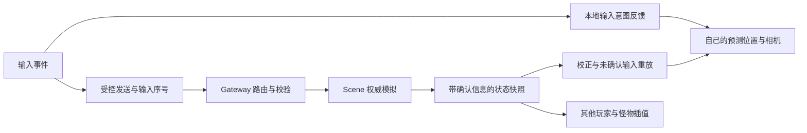

# MMO 客户端操作响应优化需求

版本：1.0 · 日期：2026-11-11 · 状态：需求整理，待实施。

本文件用于后续开发与验收。本次交付仅整理文档，现有客户端代码、服务端代码和线上配置保持当前版本。

## 1. 问题与目标

用户当前反馈：连接不再报超时，但按下移动键后，角色仍然慢半拍才开始移动。此前的画面跳动与跨地域带宽不足已分别处理；本需求重点解决输入到画面反馈的等待，并保留服务端权威判定。

目标体验：

- 按下、松开和转向后，自己的角色及随动场景及时响应。
- 服务器位置返回后自然校正，正常网络下不反复拉扯。
- 其他玩家和怪物平滑移动，避免为追求平滑增加过多显示滞后。
- 技能按键有及时反馈，伤害、消耗、冷却和突进结果以服务器为准。
- 能区分网关往返、移动回执、状态更新和本地显示延迟，便于定位后续问题。

保留现有登录档案、凭据、四个技能、死亡复活、奖励、场景切换及数值热更功能。美术升级、背包、任务、新职业、新技能和完整战斗动画不在本轮范围内。

## 2. 已确认的现状

| 项目 | 现状与证据 | 对需求的影响 |
| --- | --- | --- |
| 当前用户反馈 | 没有新的错误提示，但按键后角色慢半拍 | 优先测输入到画面的反馈，而非只测连通性 |
| 公网未登录 ping | 最新一轮 10 次约 39ms | 只代表这类网关请求的往返，不代表移动或技能完成时间 |
| 内部游戏视图 | 隧道切换后，5816 字节视图连续 40 次完整读取约 98～205ms，中位数约 150ms | 这是跨机只读探测耗时，不是客户端操作延迟 |
| 原带宽故障 | 跨地域免费 10Kbps 链路使同一视图耗时约 1.9～5.7 秒；已改用公网 SSH 加密隧道 | 本轮不以增加超时或继续调整 MTU 作为响应优化方案 |
| 当前输入 | 按键变化会立即尝试发送；100ms 定时器维持输入；一次移动请求等待回执期间合并最新方向 | 已有即时尝试发送，但发送和回执等待仍需分别测量 |
| 当前画面 | 已按 WPF 组合帧绘制，玩家、怪物、相机使用显示插值 | 已有平滑显示，尚无自己的位置预测 |
| 当前插值 | 默认约 200ms，按快照间隔自适应到约 160～300ms | 画面平滑仍可能伴随明显显示滞后 |
| 当前状态推送 | Gateway 名义每 200ms 调度一次，目标约 5Hz；实际频率受请求与 I/O 调度影响 | 必须记录实际到达间隔与状态年龄 |
| 当前 Gateway | 同一玩家连接内串行执行移动、视图、会话检查、快照保存等工作 | 一次较慢内部调用可能延后其他请求 |
| 当前移动协议 | `move` 成功只返回 `accepted: true`，视图没有移动确认序号和移动参数 | 完整预测与校正需要协议配合，不能直接假定已有确认信息 |
| 场景模拟 | 默认 20Hz；当前移动速度默认 6 世界单位/秒，边界为 ±100；输入失联后最多延续移动 250ms | 未来客户端应取得实际运动参数，不能永久写死这些默认值 |

基线源码：`114698c`；当前服务镜像：`transport-20261106-v1`。既有测量范围见[验证记录](VALIDATION.md)，链路配置见[SSH 隧道说明](SCENE_SSH_TUNNEL.md)。

用户反馈和上述基线不能直接推出精确的按键延迟。目前尚未记录“输入事件 → 首个对应显示帧”的完整数据。

## 3. 延迟如何形成

当前移动需要经过输入处理、请求发送、Gateway 排队、跨机调用、Scene 模拟、后续状态读取与推送，最后再经过客户端插值和绘制。每一段都可能增加等待。

不能简单把 39ms ping、150ms 视图探测、200ms 状态周期和200ms 插值直接相加当成实测值：这些数值的测量路径不同，部分工作也可能重叠。后续必须按同一次输入关联测量。

拟采用的职责关系如下，图中预测和确认协议均为待开发需求：

## 4. 功能需求

### R1. 输入采集与发送 · P0

1. 按下、松开、转向和窗口失去焦点时，立即更新本地输入意图。
2. 本地显示反馈不等待上一条移动请求回执。
3. 网络发送保持有界频率；积压时合并过时方向，保留最新的停止或转向意图。不得为每帧输入无限创建请求。
4. 输入序号保持单调递增，不能因失败重试、连接切换或队列合并导致旧方向覆盖新方向。
5. 断开、登录切换、场景迁移和死亡状态下，按相应状态清理或暂停输入。

### R2. 自己角色的移动预测 · P0，依赖 R6

1. 在健康连接中，按输入方向提前更新自己的显示位置，并让相机同步响应。
2. 预测使用服务器提供或协商的速度、边界、模拟步长和输入有效期；斜向移动归一化，不能额外加速。
3. 预测坐标与权威坐标独立保存。预测不能修改角色持久化位置、血蓝、命中、奖励或场景归属。
4. 松键后立即停止新增本地移动预测；后续服务器校正允许反映尚在途中的真实移动。
5. 输入长期未确认、状态流中断或请求明确失败时，停止继续扩大预测误差。建议未确认输入的预测有效期不超过服务器输入有效期，当前默认上限为 250ms。
6. 重复旧快照不能无限延长预测有效期；网络恢复后按权威状态收敛。

按键高亮或方向图标只能作为输入提示，不能代替角色或随动场景的实际移动反馈。

### R3. 权威校正与状态重建 · P0

1. 按快照确认信息移除已处理输入，只重放尚未确认的输入；重放时使用同一套运动约束。
2. 小偏差平滑修正，大偏差或明确位移事件及时重建显示基线；阈值可配置并通过验收锁定。
3. 登录会话、`owner_epoch`、场景或模拟 Tick 重置时，清除旧场景的预测历史，避免把旧输入带到新归属。
4. 死亡、复活和突进等事件以权威结果校正；保留事件去重，不能重复应用同一次突进。
5. 所有预测历史、待确认输入与修正队列均有容量和时间上限。

### R4. 其他对象与相机 · P0

1. 自己采用预测后的显示位置；其他玩家与怪物按服务器快照平滑显示。
2. 插值缓冲根据实际状态间隔和抖动设置，平滑度与显示滞后一起验收，不能只提高绘制帧率。
3. 同一帧的角色、目标指示、点击选择和相机使用一致的显示坐标，避免视觉抖动或点不中画面中的目标。
4. 技能距离、命中和碰撞最终仍使用权威状态。不要通过修改权威对象来复用显示坐标。

### R5. 战斗反馈 · P1

1. 技能按键或按钮立即给出输入反馈；等待结算期间能看出请求已提交。
2. 本轮只预反馈施法意图，不预先结算伤害、治疗、法力、冷却或突进终点。
3. 服务器拒绝技能时，清除待处理反馈并显示原因；不通过生成新动作编号自动重复施法。
4. 血蓝和冷却按服务器结果更新，重连或跨场景不能刷新已存在的消耗与冷却。
5. 断流后收到历史事件时，按事件 ID 去重；过期事件可汇总说明，避免把多次旧伤害当作同时发生的新伤害播放。

### R6. 移动确认与协议支持 · P0

完整的可校正预测包含服务端依赖。当前 `accepted: true` 只说明移动命令被接受，不能当作某个位置已经包含该输入的证明。

| 所需信息 | 要求 |
| --- | --- |
| 场景与身份 | 保留场景、角色、owner/session epoch，跨归属后不得沿用旧预测 |
| 权威模拟 Tick | 保留无符号整数语义，明确快照位置对应哪一个模拟步 |
| 输入确认序号 | 明确该序号与模拟步的关系；区分收到、接受、消费与已纳入位置快照 |
| 运动参数 | 提供实际移动速度、Tick 频率、位置约束和输入有效期 |
| 动作位移事件 | 保留事件 ID、动作类型与发生 Tick，用于突进、复活等校正 |
| 能力或版本信息 | 新旧服务端能协商能力；缺少必要信息时退回已有权威位置显示方式 |

字段名称与精确确认语义需先经过协议评审，再实施两端逻辑。Gateway 必须完整转发所需字段；不能因使用旧 DTO 而丢失新元数据。

不依赖协议升级的阶段，可以先做输入意图反馈和测量；完整位置预测与准确重放须在确认契约明确后交付。

### R7. Gateway 调度与状态推送 · P1，按测量结果实施

1. 分别测量移动、视图、会话检查与快照保存的排队及 I/O 时间，识别哪些工作阻塞输入。
2. 优化较慢 I/O 的调度，但继续保持连接路由、会话和归属状态的单一写入职责。
3. 异步结果返回时核对请求所属的场景和 epoch；旧结果不能覆盖迁移后的路由或视图。
4. 状态积压时优先交付较新的完整快照，避免持续排队发送过时画面。
5. 保留动作顺序、幂等、迁移和资产一致性，不以无约束并发换取表面低延迟。
6. 核对名义推送周期与实际到达间隔。是否提高到 10Hz，应在带宽、CPU和显示滞后测量后决定，不直接按绘制帧率增加网络推送。

### R8. 测量、兼容与回退 · P0

诊断信息至少区分以下指标；默认玩家界面保持简洁，详细信息放在开发诊断入口中。

| 指标 | 定义 |
| --- | --- |
| 网关 ping 往返 | 发送 ping 到收到回执；同一连接的排队也可能包含在内 |
| 输入到发送 | 客户端收到输入事件到请求实际进入发送流程 |
| 移动回执耗时 | 移动请求发送到回执，不等于角色首次显示变化 |
| 输入到画面 | 客户端收到输入事件到首个对应移动显示帧 |
| 状态间隔/状态年龄 | 接收频率、间隔分布，以及状态在展示前的滞后 |
| 绘制帧率 | 实际提交显示帧的速率，独立于服务器 Tick 与状态 Hz |
| 预测校正 | 校正次数、距离分布、硬校正及停止预测的原因 |

使用关联请求/输入编号与各进程内单调时钟测量。跨主机绝对时间不能在未校准时直接相减。日志不包含玩家 token、内部密钥或数据库密码。

预测功能应有开发配置开关，支持回退至现有方式。保留现有 DPAPI 凭据和档案映射，不要求玩家重新注册或清空数据。

## 5. 建议验收标准

下列数值是待评审的目标，不是当前版本已达到的结果。基准环境为 Windows x64、60Hz 显示、窗口可见、无明显系统资源瓶颈；使用规定的网络条件和同一测试路线。

| 项目 | 建议目标 |
| --- | --- |
| 输入到首个对应移动显示帧 | 正常链路下 P95 ≤50ms；开始、停止、转向分别统计 |
| 本地输入到发送 | 发送通道未拥塞时 P95 ≤20ms；积压场景另测队列上限与最新意图生效 |
| 稳态绘制 | 60Hz 基准环境下约 55～60fps，同时报告卡帧分布 |
| 普通移动校正 | 正常链路下校正距离 P95 建议 ≤0.5 世界单位；非位移事件的单次校正建议 ≤1.5 世界单位 |
| 断流预测上限 | 不超过协商的输入有效期；不得无限外推 |
| 持续测试 | 正常链路连续移动、停走和转向至少 10 分钟，无秒级请求积压、持续漂移或无界队列增长 |
| 权威一致性 | 预测开关不改变伤害、血蓝、金币、冷却、归属、迁移或动作幂等结果 |

输入到画面的起点是客户端收到输入事件，不包含此前的硬件扫描和操作系统输入队列。相机跟随时，验收应检查角色世界坐标或随动场景的可见变化，不能只检查角色是否在屏幕中心。

校正距离阈值应在首轮基准数据后确认；调整时记录理由，不以放宽阈值掩盖位置漂移。

### 验收场景

| 编号 | 场景 | 重点 |
| --- | --- | --- |
| A1 | 回环/理想网络 | 输入反馈、归一化速度、边界与权威一致 |
| A2 | 当前公网与跨地域隧道 | 网关 ping 约 40ms、内部视图约 100～200ms、名义 5Hz 状态下测首帧与校正 |
| A3 | 快速停走、反向、斜向、方向键与按钮混用 | 最新方向与松键生效，速度不叠加 |
| A4 | 抖动、200ms 级往返和短时丢包 | 队列有界、预测受限、恢复后收敛；不承诺与理想网络相同的权威回执时间 |
| A5 | 500ms～2s 断流、断开和重连 | 停止新增预测，清理旧会话，恢复正确角色与位置 |
| A6 | 死亡、复活、突进和场景迁移 | 按权威结果重建；无旧输入串场，无重复位移或结算 |
| A7 | 多个玩家、怪物和事件同时出现 | 相机、点击选择和其他对象平滑；帧率与网络频率分开记录 |
| A8 | 新旧协议、预测关闭、数值热更 | 能力协商、兼容回退、旧冷却保留；凭据与数据不受影响 |

## 6. 交付与实施顺序

| 阶段 | 交付物 | 进入下一阶段的条件 |
| --- | --- | --- |
| S0：补齐测量 | 指标定义、同一次输入的关联记录、现有版本基线 | 能区分网络、排队、状态间隔与显示等待 |
| S1：明确契约 | 输入确认、Tick与运动参数协议说明、兼容策略 | 客户端与服务端对确认语义达成一致 |
| S2：移动响应 | 有界预测、校正、生命周期重置、功能开关 | A1～A6 与权威一致性检查通过 |
| S3：显示和战斗反馈 | 其他对象插值策略、技能意图反馈、历史事件处理 | A7、A8 及既有业务回归通过 |
| S4：服务端调度优化 | 按 S0 数据定位的队列/I/O 优化及对比报告 | 证明降低了等待，同时保持归属和事务约束 |

最终交付应包括实现说明、协议变更、可回退配置、可运行客户端、测试环境与指标报告。报告同时给出输入首帧、移动回执、状态间隔和绘制帧率，不能只提供 ping 或 FPS。

本轮文档整理不启动上述实施，也不要求现在更新客户端或线上镜像。

## 7. 源码定位

| 内容 | 文件 |
| --- | --- |
| 输入、发送、回执与窗口生命周期 | [MainWindow.xaml.cs](../desktop/MMO.Client/MainWindow.xaml.cs) |
| 显示插值与状态重建 | [WorldPresentation.cs](../desktop/MMO.Client.Core/WorldPresentation.cs) |
| 绘制、相机与目标选择 | [WorldCanvas.cs](../desktop/MMO.Client/WorldCanvas.cs) |
| 当前客户端协议模型 | [Models.cs](../desktop/MMO.Client.Core/Models.cs) |
| 网关请求与状态调度 | [server.go](../internal/gateway/server.go) |
| 权威移动、输入有效期和视图 | [scene.cpp](../scene/src/scene.cpp) |
| 现有客户端操作与凭据说明 | [DESKTOP_CLIENT.md](DESKTOP_CLIENT.md) |
