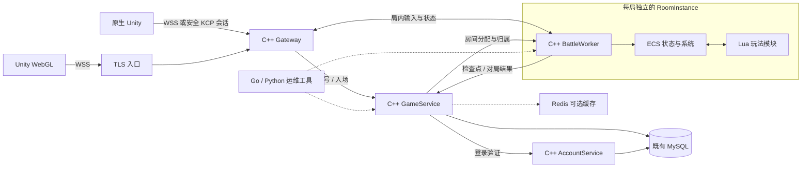

# C++ 游戏服务技术栈迁移方案

日期：2026-11-13，Asia/Shanghai。用户已选择：玩家网关也迁至 C++，Go 主要用于运维工具。**阶段 1 / 2 的 C++ Gateway、AccountService、GameService 首版代码已实现，见 [核心服务构建与切换](NATIVE_CPP_RUNBOOK.md) 及 [验证记录](VALIDATION.md)。ECS、Lua、Protobuf 与安全 KCP 尚未实现；现网继续使用原有已验证服务，不能把源码完成写成全量上线。**

目标采用 C++ 游戏服务、Lua 玩法、组件化房间状态和 Protobuf 协议。原生 Unity 可增加 KCP 入口，WebGL 保留 WSS。现有账号、角色、数据库、四个 WSS 玩法入口及长期资产继续兼容。参考目标是这种技术分工，不以社区逆向表格作为某款商业游戏完整实现的证明。

## 用户确定的语言边界

| 层 | 目标 | 迁移责任 |
| --- | --- | --- |
| 玩家网关 | C++ 网络接入、会话、协议、限流和路由 | 替换自研 Go WebSocket Bridge 与 Gateway |
| 账号鉴权 | C++ AccountService | 替换 Go Auth，兼容旧身份、密码哈希和票据 |
| 角色与大厅后台 | C++ GameService | 替换 Go Backend 的角色、房间、迁移、奖励与存档 |
| 实时房间 | C++ BattleWorker / RoomInstance | 复用现有场景算法，建立逐局隔离和 ECS |
| 玩法脚本 | 服务端可信 Lua 模块 | 技能编排、Buff、怪物和任务等玩法逐步移入 |
| 消息协议 | Protobuf 与旧 JSON 适配层 | 同一业务语义，分别编码给新旧客户端 |
| 传输 | 原生 KCP 可选，浏览器 WSS | 两类入口使用同一套会话和业务分发 |
| 长期数据 | 既有 MySQL | 维持原数据、事务、单写入者和角色身份 |
| 缓存 | Redis 按需接入 | 在线状态、房间索引、短期缓存；不成为资产事实来源 |
| 运维工具 | Go / Python | 发布、迁移检查、配置工具、探针和压测 |
| 构建部署 | Linux / GCC、CMake、Docker、GitHub Actions | 继续由构建机生成镜像，VPS 拉取运行 |

Go Auth/Backend 可作为分阶段迁移期间的兼容服务；它们仍承接玩家业务时，不能宣布最终目标已经完成。现有 Caddy 可以继续作为 TLS 与证书基础设施，自研 Go 游戏网关和 bridge 则需要被替换。

## 目标调用链

game 主机承载 C++ Gateway、GameService 和少量 BattleWorker；auth 主机运行 C++ AccountService。大厅、房间管理和分配器初期可以是 GameService 内的模块。实时房间继续集中在 game，跨地域 auth 仅处理账号和登录。

## C++ 内核与 Lua 的职责

C++ 保有连接、时间推进、ECS、AOI、物理碰撞、资源消耗、最终伤害、状态版本和持久化提交。Lua 通过受约束的宿主 API 编排玩法，例如选择效果、发出弹道生成请求、施加 Buff、安排怪物阶段。Lua 不能绕过宿主规则直接改数据库、修改别人的房间或伪造结算结果。

客户端继续提交技能 ID 和参数。服务端校验后把它们绑定到已发布的行为模块；客户端不上传可执行 Lua 源码。当前弹道和墙体先迁成与旧规则等价的实现，再扩展新的行为。

### ECS 组件与系统

建议首批组件为 Transform、Velocity、Collider、CombatStats、SkillBook、Cooldowns、Projectile、Wall、Lifetime 和 Owner。系统按固定阶段处理输入、冷却、移动、碰撞、伤害、死亡、销毁和事件。账号资料与长期金币不需要强行变成 ECS 组件。

每个 RoomInstance 独立持有组件注册表、Tick、随机源、实体和事件。一个 Worker 可管理多局；每局的写入通过同一个房间执行上下文串行完成。网络线程投递命令，不能直接修改 ECS。

对外实体 ID 包含对局及世界代次，不能把 registry 内部索引当成长期玩家 ID。Lua 中的实体引用应携带房间代次与实体代次，访问已销毁或其他房间实体时拒绝执行，避免悬空引用。

### Lua 执行与更新

初期每房间独立 Lua 状态，便于隔离脚本变量。设置分配额度、指令预算、宿主调用额度和对象数量上限；指令 Hook 不能约束所有宿主 C++ 调用，所以每个宿主 API 也要限制输入规模和工作量。脚本异常使用受保护调用捕获，不越过进程边界。

先收集脚本发出的效果命令，验证完整批次后再提交资源与状态变化，避免脚本中途失败却只扣除部分 MP 或生成半套效果。宿主只暴露游戏需要的能力，不默认开放文件、系统命令或任意模块加载。

每局固定脚本与规则版本。发布新脚本先加载校验，再分配给新对局；旧对局完成后回收旧版本。活动对局内替换脚本要另做状态迁移与回滚验证，不能仅靠重新加载文件宣称实现不停机更新。

## 传输与协议兼容

### WSS 与 KCP 共用业务分发

浏览器不提供原生 TCP/UDP 套接字访问，因此保留 WSS；Protobuf 可以通过 WebSocket 二进制帧传输，不要求一定使用 KCP。[Unity Web 网络说明](https://docs.unity3d.com/6000.0/Documentation/Manual/webgl-networking.html)

原生 Unity 可经 KCP 传输可靠实时消息。KCP 是需要应用提供底层收发与时钟的 ARQ 算法，不替代账号认证、加密、会话建立、重放防护和业务去重。[KCP 作者说明](https://github.com/skywind3000/kcp)

账号密码只在受信任 TLS 链路提交。UDP 接入需采用审查过的加密会话/DTLS 等完整保护方案，再绑定短期入场授权、玩家和对局；不能直接用可猜测 conv 号作为认证，也不能在明文 UDP 中发送长期凭据。精确加密实现和依赖版本在网络阶段完成选型及测试后固定。

两个传输适配器都输出相同的业务命令，进入共同的 SessionManager、权限检查、路由和房间命令队列。不能为 WSS 和 KCP 各写一套技能与扣血逻辑。

### Protobuf 迁移规则

- 新消息需要版本、请求 ID、命令类型和明确的字段存在性；角色和房间权限从已验证会话派生，不能信任客户端填写的身份。
- 施法、移动、进场、完整快照和事件使用类型化消息，保留世界代次、定义版本、动作去重和事件游标语义。
- 字段号一旦发布不复用；删除字段后保留编号。浮点输入仍拒绝 NaN/Infinity，不能把能解码等同于业务合法。[Protobuf 语言指南](https://protobuf.dev/programming-guides/proto3/)
- 方向为零、缺少坐标、缺少动作序号是不同情况；不能让 proto3 默认零值掩盖必填字段缺失。
- 旧 `/ws`、`/combat/ws`、`/elemental/ws`、`/skills/ws` 继续接收原 JSON，不能直接改成二进制。新协议通过独立入口或明确协商接入。
- 旧 JSON 有数值及精度约定，ProtoJSON 的 64 位整数字段表示也有其规则；需要显式适配，不能把默认 ProtoJSON 输出直接当成旧客户端协议。
- C++、C# 与 Go 运维工具由同一份 schema 生成代码。客户端协议适配和 Unity 构建仍由相应工作区单独完成。

## 账号与数据库迁移条件

Auth 与 Backend 是两套有状态业务迁移，不能仅凭 C++ 网关能转发消息就删掉旧服务。

| 现有约定 | C++ 必须保持的行为 |
| --- | --- |
| bcrypt cost=10，密码按 UTF-8 字节检查 | 正确验证原密码哈希，不重新散列现有密码或要求玩家重注册 |
| 原长期 token 与 24 小时新票据 | 保留旧凭据，新票据独立存储、到期和轮换 |
| `legacy_token_hash` | 首次创建角色使用稳定兼容哈希，不能改成临时票据哈希 |
| 账号名与 MySQL VARBINARY | 保持原大小写、Unicode 和唯一性语义 |
| `roles/claims/migrations/combat_snapshots` | 保持原角色、资产、未完迁移、快照和版本检查 |
| 真实账号没有 DELETE 权限 | 登录票据继续最多五条记录，使用 UPDATE 复用 |
| 固定 MySQL 会话上的命名锁 | 锁与业务写入绑定同一连接；断开后停止写入，不能自动重连后绕过锁 |
| MySQL 匹配行数语义 | 驱动开启等价于 CLIENT_FOUND_ROWS 的行为，防止静止检查点被误判为冲突 |

现有锁名为 `mmo-backend:` / `mmo-auth:` 加数据库名转小写后 SHA-256 的前 24 字节的十六进制字符串。C++ 必须与旧服务竞争同一命名锁，不能换个锁名让新旧写入者同时运行。MySQL 数据库连接参数继续使用独立配置字段和预处理语句，不拼接含玩家输入的 SQL。[MySQL C API 连接选项](https://dev.mysql.com/doc/c-api/8.4/en/mysql-real-connect.html)

Redis 用于可重建的索引和缓存，房间实时状态仍在 Worker 内存，资产仍由 MySQL 事务确认。Redis 暂不可用时的降级、缓存版本和过期需要明确；不能把 Redis TTL 锁作为保证旧业务写入者失效的唯一机制。

## 分阶段替换与验收

阶段顺序以兼容性和可独立回退为准，避免同时改变语言、战斗模型、传输和客户端协议。

| 阶段 | 交付内容 | 必须通过 |
| --- | --- | --- |
| 0 技术路线 | 当前方案、模块边界、兼容与验证清单 | 与现有代码和用户选择一致；已完成 |
| 1 C++ 玩家网关 | 替换自研 Go Bridge/Gateway，旧 Go Auth/Backend 暂时兼容 | 四种旧 WSS profile、Origin/TLS、帧限制、登录、移动、技能、状态、断线和旧会话隔离 |
| 2 C++ 账号与业务后台 | 替换 Auth、角色/迁移/奖励/存档，保持旧库 | 原密码/长期 token、新票据轮换、重启身份一致、无 DELETE 权限、迁移故障恢复、幂等奖励和数据库锁丢失 |
| 3 房间与 ECS Lua | 独立 RoomInstance，移植旧规则后增加 Lua 编排 | 双房间隔离、旧技能等价、脚本超限/失败无部分提交、版本固定、房间结束回收和重连 |
| 4 Protobuf 与原生 KCP | 新二进制协议、C# schema、受保护的 KCP 接入 | 新旧协议行为一致、授权和重放检查、丢包/乱序/限速测试、WebGL WSS 保留 |
| 5 运维与规模化 | Go 探针/发布、指标、按需 Redis | 可观测、可排空旧对局后发布、数据核对、缓存故障及回退演练 |

阶段 1 的 C++ 网关需保留输入与慢 I/O 分离、自动 view 在途上限、旧结果丢弃、异步快照的顺序，以及最终断开保存。网络代码不应退回“一个阻塞请求卡住整条连接”的实现。

阶段 2 完成后，自研 Go 服务才可以退出账号与游戏业务链路。旧 Go 实现可保留为回归对照和回退材料；最终迁移完成以实际运行依赖检查为准，不以文件扩展名或构建成功为准。

阶段 3 的 ECS 迁移先复用现有移动、连续碰撞、弹道/墙体及代次规则。Lua 首批行为与原规则做同输入、同 Tick、同预期结果的对照；增加新技能放在等价性通过之后。每房间和 Worker 都需要输入、实例、队列和 Tick 工作量上限。

## 实现入口与技术候选

| 现有代码 | 目标落点 |
| --- | --- |
| `internal/wsbridge/`、`internal/gateway/` | 新 `native/gateway/` 与 `native/session/` |
| `internal/authsvc/` | 新 `native/account/` |
| `internal/backend/identity.go`、`accounts.go`、`transfer.go`、`combat.go`、`store*.go` | 新 `native/game_service/`、`native/persistence/` |
| `scene/src/scene.hpp`、`scene.cpp` | 新 `native/room/`、`native/ecs/`，保留旧 Scene 供回归 |
| `scene/src/abilities.cpp`、`skill_lab.cpp`、`elemental.cpp` | 原算法移入系统，新增受限 `native/script/` 宿主 API 与 `scripts/gameplay/` |
| 旧 JSON 协议文档 | 新 `protocol/native/v1/` schema 与旧 JSON 适配规范 |
| `.github/workflows/`、`scripts/` | C++ 镜像构建、回归、探针和 Go/Python 运维工具 |

`native/gateway/`、`native/account/`、`native/game_service/`、`native/persistence/` 现已包含可运行 C++17 服务与独立回归；会话 actor 暂在 Gateway 模块内。网络使用 [Boost.Asio/Beast](https://www.boost.org/doc/libs/latest/libs/beast/doc/html/index.html)，Linux 依赖由 Ubuntu 24.04 镜像安装，源码依赖不拉取漂移 master。房间/ECS/Lua/新协议目录仍是后续规划，组件注册表候选为 [EnTT](https://github.com/skypjack/entt)，Lua 候选为官方 C API；没有将候选库放进仓库后就声称已经接入。现有场景和新核心目前均保持 C++17。

Lua 的内存分配器、受保护调用与指令 Hook 可由官方 C API 提供，宿主仍需补充完整预算和能力限制。[Lua API](https://www.lua.org/source/5.4/lua.h.html)

## 部署与完成标准

继续 Docker 和 GitHub Actions。两台小规格 VPS 先保持少量进程，构建与镜像打包在本机或 CI 完成；不为模仿技术栈而同时引入 Kubernetes 和另一套 Jenkins。集群化在实际需要多战斗主机与资源调度后再评估。

每个阶段使用独立端口、测试数据库和新镜像标签验证；旧入口保留到兼容测试完成。验证顺序是本地单元/原生进程、Linux CI、隔离 MySQL/容器、目标机、真实客户端网络。Unity 页面及原生客户端测试各自记录，不能以服务器探针代替画面验收。

上线前完成一致数据库备份，核对账号、身份哈希、金币、快照及未决迁移。切换 Auth/Backend 写入者时先停止旧写入者，再使 C++ 获取相同数据库锁；不会让新旧进程同时写库。回退代码或镜像不等于恢复旧数据库，不能覆盖切换后新增的数据。

最终完成需要：玩家网关、账号、角色业务及战斗实际由 C++ 承担；Lua 玩法预算及版本机制可用；旧账号与四个 WSS 入口兼容；新协议与原生传输通过测试；Go 仅保留运维工具。当前交付核心服务替换实现与隔离验收、部署/回退入口；后续阶段及现网切换分别验收，不宣布全量迁移或性能提升。
