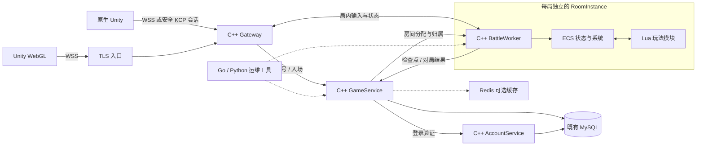

# C++ 游戏服务技术栈迁移方案

日期：2026-11-13，Asia/Shanghai。用户已选择：玩家网关也迁至 C++，Go 主要用于运维工具。**阶段 1 / 2 的 C++ Gateway、AccountService、GameService 已有历史验证与镜像记录；本轮增加阶段 3 的多房间 Worker、EnTT 权威存储和受限 Lua 技能编排。见 [核心服务构建与切换](NATIVE_CPP_RUNBOOK.md)、[房间交接](ROOMS_LUA_ECS.md)及 [验证记录](VALIDATION.md)。房间候选镜像 cpp-room-91f4800c8a13 已通过完整 CI 并发布，未切换 VPS；Protobuf 与安全 KCP 仍未实现。**

目标采用 C++ 游戏服务、Lua 玩法、组件化房间状态和 Protobuf 协议。原生 Unity 可增加 KCP 入口，WebGL 保留 WSS。现有账号、角色、数据库、四个 WSS 玩法入口及长期资产继续兼容。参考目标是这种技术分工，不以社区逆向表格作为某款商业游戏完整实现的证明。

## 用户确定的语言边界

| 层 | 目标 | 迁移责任 |
| --- | --- | --- |
| 玩家网关 | C++ 网络接入、会话、协议、限流和路由 | 替换自研 Go WebSocket Bridge 与 Gateway |
| 账号鉴权 | C++ AccountService | 替换 Go Auth，兼容旧身份、密码哈希和票据 |
| 角色与大厅后台 | C++ GameService | 替换 Go Backend 的角色、房间、迁移、奖励与存档 |
| 实时房间 | C++ Worker / RoomInstance | 已复用现有场景算法，每房间独立 EnTT registry、Tick、事件与世界代次 |
| 玩法脚本 | 服务端可信 Lua 5.4 模块 | 已实现弹道/墙体生成计划；Buff、怪物与任务脚本尚属后续扩展 |
| 消息协议 | Protobuf 与旧 JSON 适配层 | 同一业务语义，分别编码给新旧客户端 |
| 传输 | 原生 KCP 可选，浏览器 WSS | 两类入口使用同一套会话和业务分发 |
| 长期数据 | 既有 MySQL | 维持原数据、事务、单写入者和角色身份 |
| 缓存 | Redis 按需接入 | 在线状态、房间索引、短期缓存；不成为资产事实来源 |
| 运维工具 | Go / Python | 发布、迁移检查、配置工具、探针和压测 |
| 构建部署 | Linux / GCC、CMake、Docker、GitHub Actions | 继续由构建机生成镜像，VPS 拉取运行 |

Go Auth/Backend 可作为分阶段迁移期间的兼容服务；它们仍承接玩家业务时，不能宣布最终目标已经完成。现有 Caddy 可以继续作为 TLS 与证书基础设施，自研 Go 游戏网关和 bridge 则需要被替换。

## 目标调用链

该图包含后续传输和缓存目标，当前入口仍为旧 JSON WebSocket / TCP，未接入 KCP、Protobuf 或 Redis。部署目标是 game 主机承载 C++ Gateway、GameService 和 Worker，auth 主机运行兼容 AccountService。当前房间目录与创建/加入编排在 GameService 内，尚无自动匹配和跨 Worker 分配器；实时房间继续集中在 game，跨地域 auth 仅处理账号和登录。

## C++ 内核与 Lua 的职责

C++ 保有连接、时间推进、ECS、AOI、物理碰撞、资源消耗、最终伤害、状态版本和持久化提交。当前 Lua 仅通过 `host.emit(type,skill_id)` / `host.deny(reason)` 选择与已注册定义一致的单条弹道或墙体生成计划。具体数值与结算仍由 C++ 执行；近战等旧玩法继续使用原 C++ 规则。Buff、怪物阶段和任务脚本 API 尚未实现。Lua 不能直接改数据库、修改别人的房间或伪造结算结果。

客户端继续通过原 `skill_init` 提交技能 ID 和完整参数；C++ 校验后，施法调用房间绑定的可信行为模块。客户端不上传可执行 Lua 源码。当前弹道、墙体沿用旧连续碰撞与伤害算法，房间命令作为旧 JSON 的可选扩展，旧客户端无需发组房命令。

### ECS 组件与系统

已接入 EnTT v3.13.2：玩家、元素候选角色、NPC、Projectile 和 Wall 直接存于 registry 组件池，排序索引只持有实体句柄，保留原确定性遍历与稳定引用。玩家状态目前是聚合组件，尚未把 Transform、CombatStats、SkillBook 等每个字段拆开；不存在每 Tick 复制一套战斗状态的镜像。输入、冷却、移动、碰撞、伤害、死亡和事件继续使用原 C++ 算法。账号资料与长期金币仍由后台和数据库管理。

每个 RoomInstance 独立持有 Scene、组件注册表、世界代次、Tick、实体、事件与不可变脚本引用。一个 Worker 可管理多局，单条逻辑执行流串行处理有界命令并推进房间；网络线程不能直接修改 ECS。房间有 lobby / playing / finished 生命周期，容量、队列和每 Tick 工作量有上限；当前不提供跨 Worker 调度。

对外继续使用旧角色 ID、对象 ID 与世界/会话代次，registry 内部索引不作为长期玩家 ID。房间路由、角色 owner/session 和 world_epoch 共同围栏迟到请求；Lua 只收到规范化上下文，不持有可跨调用保存的 ECS 指针。

### Lua 执行与更新

每次规划调用使用新 Lua VM，房间固定不可变源码引用，避免全局变量和失败调用污染后续施法或其他房间；持续玩法状态留在 ECS。默认额度为 1 MiB 内存、50,000 指令、16 次暴露宿主调用、单条效果，源码 64 KiB、上下文 8 KiB，另限制深度、字符串与输出。脚本异常受保护捕获，未开放 io/os/package/debug、任意 load 或随机源；宿主 API 本身也受预算约束。

先收集脚本发出的效果命令，验证完整批次后再提交资源与状态变化，避免脚本中途失败却只扣除部分 MP 或生成半套效果。宿主只暴露游戏需要的能力，不默认开放文件、系统命令或任意模块加载。

每局固定脚本 version + SHA-256，Backend 持久化两者。发布只从服务器配置的 manifest 加载并校验常规文件，成功后供新房间使用；旧房间继续持有旧源码。保留 `versions/<version>.json` 和旧源码供重启恢复，版本或 SHA 不匹配时拒绝恢复。动态房间数值配置同样固定，旧默认场景保留原热更接口。活动对局任意代码热换未实现。

Worker 重启可以由持久目录重建房间并恢复已存角色，使用新世界代次、回到 lobby；不承诺恢复临时弹道、墙体或未存战斗进度。结束后的回收必须先提交最终 SQL 存档，再精确确认并移除实体，不能仅按断线时间删角色。接口与失败边界见 [房间交接](ROOMS_LUA_ECS.md)。

## 传输与协议兼容

### 后续阶段：WSS 与 KCP 共用业务分发

以下是尚未实现的网络迁移约束；本轮继续旧 JSON WebSocket / TCP，不以房间内核完成代表传输已更新。

浏览器不提供原生 TCP/UDP 套接字访问，因此保留 WSS；Protobuf 可以通过 WebSocket 二进制帧传输，不要求一定使用 KCP。[Unity Web 网络说明](https://docs.unity3d.com/6000.0/Documentation/Manual/webgl-networking.html)

原生 Unity 可经 KCP 传输可靠实时消息。KCP 是需要应用提供底层收发与时钟的 ARQ 算法，不替代账号认证、加密、会话建立、重放防护和业务去重。[KCP 作者说明](https://github.com/skywind3000/kcp)

账号密码只在受信任 TLS 链路提交。UDP 接入需采用审查过的加密会话/DTLS 等完整保护方案，再绑定短期入场授权、玩家和对局；不能直接用可猜测 conv 号作为认证，也不能在明文 UDP 中发送长期凭据。精确加密实现和依赖版本在网络阶段完成选型及测试后固定。

两个传输适配器都输出相同的业务命令，进入共同的 SessionManager、权限检查、路由和房间命令队列。不能为 WSS 和 KCP 各写一套技能与扣血逻辑。

### 后续阶段：Protobuf 迁移规则

- 新消息需要版本、请求 ID、命令类型和明确的字段存在性；角色和房间权限从已验证会话派生，不能信任客户端填写的身份。
- 施法、移动、进场、完整快照和事件使用类型化消息，保留世界代次、定义版本、动作去重和事件游标语义。
- 字段号一旦发布不复用；删除字段后保留编号。浮点输入仍拒绝 NaN/Infinity，不能把能解码等同于业务合法。[Protobuf 语言指南](https://protobuf.dev/programming-guides/proto3/)
- 方向为零、缺少坐标、缺少动作序号是不同情况；不能让 proto3 默认零值掩盖必填字段缺失。
- 旧 `/ws`、`/combat/ws`、`/elemental/ws`、`/skills/ws` 继续接收原 JSON，不能直接改成二进制。新协议通过独立入口或明确协商接入。
- 旧 JSON 有数值及精度约定，ProtoJSON 的 64 位整数字段表示也有其规则；需要显式适配，不能把默认 ProtoJSON 输出直接当成旧客户端协议。
- C++、C# 与 Go 运维工具由同一份 schema 生成代码。客户端协议适配和 Unity 构建仍由相应工作区单独完成。

## 账号与数据库迁移条件

Auth 与 Backend 是两套有状态业务迁移，不能仅凭 C++ 网关能转发消息就删掉旧服务。

| 现有约定 | C++ 必须保持的行为 |
| --- | --- |
| bcrypt cost=10，密码按 UTF-8 字节检查 | 正确验证原密码哈希，不重新散列现有密码或要求玩家重注册 |
| 原长期 token 与 24 小时新票据 | 保留旧凭据，新票据独立存储、到期和轮换 |
| `legacy_token_hash` | 首次创建角色使用稳定兼容哈希，不能改成临时票据哈希 |
| 账号名与 MySQL VARBINARY | 保持原大小写、Unicode 和唯一性语义 |
| `roles/claims/migrations/combat_snapshots` | 保持原角色、资产、未完迁移、快照和版本检查 |
| 真实账号没有 DELETE 权限 | 登录票据继续最多五条记录，使用 UPDATE 复用 |
| 固定 MySQL 会话上的命名锁 | 锁与业务写入绑定同一连接；断开后停止写入，不能自动重连后绕过锁 |
| MySQL 匹配行数语义 | 驱动开启等价于 CLIENT_FOUND_ROWS 的行为，防止静止检查点被误判为冲突 |

现有锁名为 `mmo-backend:` / `mmo-auth:` 加数据库名转小写后 SHA-256 的前 24 字节的十六进制字符串。C++ 必须与旧服务竞争同一命名锁，不能换个锁名让新旧写入者同时运行。MySQL 数据库连接参数继续使用独立配置字段和预处理语句，不拼接含玩家输入的 SQL。[MySQL C API 连接选项](https://dev.mysql.com/doc/c-api/8.4/en/mysql-real-connect.html)

Redis 用于可重建的索引和缓存，房间实时状态仍在 Worker 内存，资产仍由 MySQL 事务确认。Redis 暂不可用时的降级、缓存版本和过期需要明确；不能把 Redis TTL 锁作为保证旧业务写入者失效的唯一机制。

## 分阶段替换与验收

阶段顺序以兼容性和可独立回退为准，避免同时改变语言、战斗模型、传输和客户端协议。

| 阶段 | 交付内容 | 必须通过 |
| --- | --- | --- |
| 0 技术路线 | 当前方案、模块边界、兼容与验证清单 | 与现有代码和用户选择一致；已完成 |
| 1 C++ 玩家网关 | 已实现，替换自研 Go Bridge/Gateway，保留旧后端兼容 | 四种旧 WSS profile、Origin/TLS、帧限制、登录、移动、技能、状态、断线和旧会话隔离；历史证据见验证记录 |
| 2 C++ 账号与业务后台 | 已实现，替换 Auth、角色/迁移/奖励/存档，保持旧库 | 原密码/长期 token、新票据轮换、重启身份一致、无 DELETE 权限、迁移故障恢复、幂等奖励和数据库锁丢失；已有 cpp-core 历史镜像 |
| 3 房间与 ECS Lua | 已实现并发布候选：多房间、EnTT 存储、受限 Lua 弹道/墙体计划及目录/回收 | 隔离、权限、预算、版本固定、存档确认、重连与旧协议回归通过；容器及匿名拉取通过，VPS 未切换 |
| 4 Protobuf 与原生 KCP | 新二进制协议、C# schema、受保护的 KCP 接入 | 新旧协议行为一致、授权和重放检查、丢包/乱序/限速测试、WebGL WSS 保留 |
| 5 运维与规模化 | 已有 Python 房间 status/reload/drain；指标、自动调度与 Redis 待实现 | 可观测、可排空旧对局后发布、数据核对、缓存故障及回退演练 |

阶段 1 的 C++ 网关需保留输入与慢 I/O 分离、自动 view 在途上限、旧结果丢弃、异步快照的顺序，以及最终断开保存。网络代码不应退回“一个阻塞请求卡住整条连接”的实现。

阶段 2 完成后，自研 Go 服务才可以退出账号与游戏业务链路。旧 Go 实现可保留为回归对照和回退材料；最终迁移完成以实际运行依赖检查为准，不以文件扩展名或构建成功为准。

阶段 3 复用现有移动、连续碰撞、弹道/墙体及代次规则，以独立 registry 隔离房间。Lua 首批行为做同输入、同 Tick 对照并验证失败无部分提交，Worker 已设置输入、玩家、房间、队列与 Tick 工作量上限；这些保护阈值不是容量或延迟承诺。自动匹配、细粒度 ECS 拆分和通用玩法脚本继续单独验收。

## 实现入口与后续边界

| 现有代码 | 当前实现或后续落点 |
| --- | --- |
| `internal/wsbridge/`、`internal/gateway/` | `native/gateway/`，会话 actor 位于该模块内 |
| `internal/authsvc/` | 新 `native/account/` |
| `internal/backend/identity.go`、`accounts.go`、`transfer.go`、`combat.go`、`store*.go` | 新 `native/game_service/`、`native/persistence/` |
| `scene/src/scene.hpp`、`scene.cpp` | `scene/src/ecs_storage.hpp` 为权威存储，`native/room/` 复用 Scene 构造独立房间 |
| `scene/src/abilities.cpp`、`skill_lab.cpp`、`elemental.cpp` | 保留原 C++ 算法；`native/script/` 与 `scripts/gameplay/` 已接入弹道/墙体计划，elemental 个人试炼保持默认场景协议 |
| 旧 JSON 协议文档 | 原协议继续兼容；Protobuf schema 与新入口尚未实现 |
| `.github/workflows/`、`scripts/` | C++ 镜像构建、回归、探针和 Go/Python 运维工具 |

`native/gateway/`、`native/account/`、`native/game_service/`、`native/persistence/`、`native/room/`、`native/script/` 已包含 C++17 实现与回归。网络使用 [Boost.Asio/Beast](https://www.boost.org/doc/libs/latest/libs/beast/doc/html/index.html)，EnTT v3.13.2 单头文件与 MIT 许可证随仓库固定，Lua 5.4 使用官方 C API 与系统依赖；校验值见 [第三方依赖](../third_party/README.md)。Ubuntu 24.04 镜像安装系统库，源码依赖不拉取漂移 master。现有场景和新核心均保持 C++17。

Lua 的自定义内存分配器、受保护调用和指令 Hook 已由官方 C API 接入，宿主另行实施输入规模、能力和调用额度限制。[Lua API](https://www.lua.org/source/5.4/lua.h.html)

## 部署与完成标准

继续 Docker 和 GitHub Actions。两台小规格 VPS 先保持少量进程，构建与镜像打包在本机或 CI 完成；不为模仿技术栈而同时引入 Kubernetes 和另一套 Jenkins。集群化在实际需要多战斗主机与资源调度后再评估。

每个阶段使用独立端口、测试数据库和新镜像标签验证；旧入口保留到兼容测试完成。验证顺序是本地单元/原生进程、Linux CI、隔离 MySQL/容器、目标机、真实客户端网络。Unity 页面及原生客户端测试各自记录，不能以服务器探针代替画面验收。

上线前完成一致数据库备份，核对账号、身份哈希、金币、快照及未决迁移。切换 Auth/Backend 写入者时先停止旧写入者，再使 C++ 获取相同数据库锁；不会让新旧进程同时写库。回退代码或镜像不等于恢复旧数据库，不能覆盖切换后新增的数据。

房间版 game 采用第三层 `native-room-game.override.yaml`，叠加原 game 与 C++ core 覆盖层，使用另行发布且验证过的 `MMO_ROOM_IMAGE_TAG`；Auth 和其他五个 Scene 的镜像独立保留。新增 `rooms_directory`、`room_returns`，恢复意图复用原迁移日志，旧账号、token、金币和快照保留。回退至不支持房间的 Backend 前，先停止新组房并重复执行 `scripts/room_admin.py drain`，确认动态归属及未决迁移为零；旧 Backend 无法理解 `room-…` 路由。完整操作见 [运行手册](NATIVE_CPP_RUNBOOK.md)。

最终完成需要：玩家网关、账号、角色业务及战斗实际由 C++ 承担；Lua 玩法预算及版本机制可用；旧账号与四个 WSS 入口兼容；新协议与原生传输通过测试；Go 仅保留运维工具。当前源码覆盖核心服务、ECS、多房间及首批 Lua 技能计划，提供隔离验证和部署/回退入口；本轮 CI 发布、现网切换、Protobuf/KCP 与规模化分别验收，不宣布全量迁移或性能提升。
