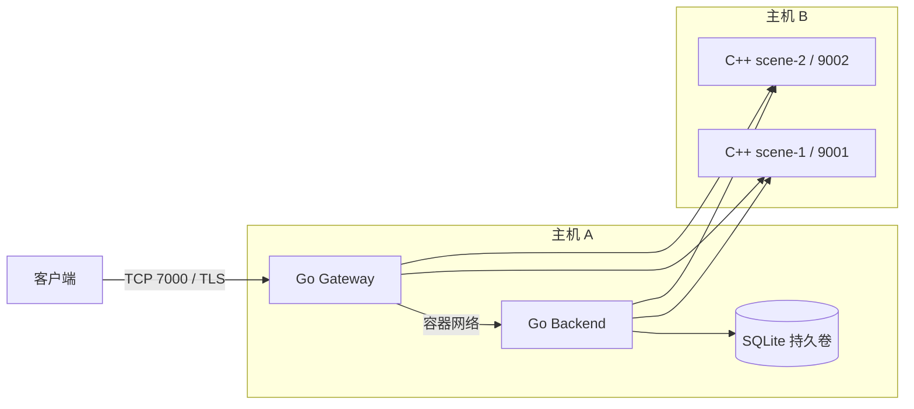

# 两台 Linux 主机部署

2 核 2 GB VPS 建议使用 [网上镜像仓库部署](REGISTRY_DEPLOYMENT.md)，直接拉取已构建镜像；也可使用 [离线镜像包](PREBUILT_IMAGES.md)。以下的网络、密钥和数据卷配置适用于这两种方式，目标机无需编译。

四个服务实例可以放在两台主机上运行。当前推荐配置：

| 主机 | 运行内容 | 对外端口 |
| --- | --- | --- |
| A：Ubuntu 24.04.4 LTS，示例私网 IP `10.20.0.11` | Go Gateway、Go Backend、SQLite 持久卷 | 玩家入口 TCP 7000；8080 健康检查仅回环地址 |
| B：OpenCloudOS 9.6，示例私网 IP `10.20.0.22` | C++ scene-1、C++ scene-2 两个容器 | 私网 TCP 9001、9002，仅允许 A 与受控运维来源访问 |

Backend 通过主机 A 的 Compose 网络提供 `http://backend:8081`，没有发布宿主机 8081 端口。数据库嵌入 Backend，不需要第三台数据库机器。A 的 Gateway 与 Backend 都会访问 B 的两个场景端口。



这套布局用于搭建和验证 MVP。A 故障会中断登录和连接，B 故障会中断两个场景；目前没有自动容灾。两机能承载多少玩家仍需结合硬件和玩法压测，不能从机器数量推算。

## 1. 准备两台机器

两台机器都安装并启动 Docker Engine 与 Compose，架构与构建镜像一致。先按 [GitHub 与 VPS 操作指南](GITHUB_VPS.md) 安装工具，再在两台机器分别执行：

```bash
git clone https://github.com/dravenlove/mmo-server.git
cd mmo-server
git rev-parse HEAD
```

核对两台机器的提交号一致。也可使用相同版本的源码包；以下命令均从源码根目录执行，部署文件中的 `build.context: ..` 会指向该目录。文档中的 `docker` 命令假设当前用户有 Docker 权限；普通 sudo 用户改用 `sudo docker`，无需为了运行本项目额外开放 Docker 管理端口。

示例假设两机能通过 IPv4 私网或 VPN 地址互通。没有私网时，先建立加密 VPN，把后面的示例地址替换为 VPN 地址；当前内部 HTTP 共享密钥不会加密流量。B 的 9001/9002 不向整个公网开放。防火墙应依据 B 实际看到的 A 出站地址限制来源，并确认 Docker 转发规则确实生效；不要假设容器来源一定是 A 的某个固定接口地址。

在可信终端生成一次密钥：

```bash
openssl rand -hex 32
```

两台机器使用同一个值；不要分别生成两份不同密钥。实际 env 文件权限设为 `600`。

## 2. 先启动主机 B 的场景

在 **B** 上：

```bash
cp deploy/two-host-b.env.example deploy/two-host-b.env
chmod 600 deploy/two-host-b.env
```

编辑 `deploy/two-host-b.env`：填写 `INTERNAL_TOKEN`，将 `SCENE_BIND_IP` 改为 **B 实际网卡上的私网或 VPN IPv4 地址**。

```bash
docker compose --env-file deploy/two-host-b.env -f deploy/two-host-b.compose.yaml -p mmo-host-b config --quiet
docker compose --env-file deploy/two-host-b.env -f deploy/two-host-b.compose.yaml -p mmo-host-b up -d --build --wait
docker compose --env-file deploy/two-host-b.env -f deploy/two-host-b.compose.yaml -p mmo-host-b ps
```

两个场景使用同一份源码和镜像，分别以 `scene-1:9001` 和 `scene-2:9002` 运行。

## 3. 再启动主机 A 的网关与业务

在 **A** 上：

```bash
cp deploy/two-host-a.env.example deploy/two-host-a.env
chmod 600 deploy/two-host-a.env
```

编辑 `deploy/two-host-a.env`：

- `INTERNAL_TOKEN`：与 B 完全相同。
- `SCENE_HOST_IP`：与 B 的 `SCENE_BIND_IP` 相同，A 的两个容器必须都能访问它。
- `GATEWAY_BIND_IP`：A 实际网卡地址。公网通过 NAT 映射时填写本机实际绑定地址；也可显式用 `0.0.0.0` 监听所有网卡，并配好入口防火墙。
- `BACKEND_VOLUME_NAME`：新部署保留默认值。已有数据迁移见后文。
- 公网入口填写 `TLS_CERT_DIR`、`TLS_CERT_FILE`、`TLS_KEY_FILE`；证书 SAN、权限和客户端 CA 步骤见 [通用部署文档的 TLS 部分](DEPLOYMENT.md#4-网关-tls)。其中环境文件应换为本节的 `two-host-a.env`。

先从 A 检查 B，替换下面的示例地址：

```bash
curl --fail http://10.20.0.22:9001/healthz
curl --fail http://10.20.0.22:9002/healthz
```

然后启动 A：

```bash
docker compose --env-file deploy/two-host-a.env -f deploy/two-host-a.compose.yaml -p mmo-host-a config --quiet
docker compose --env-file deploy/two-host-a.env -f deploy/two-host-a.compose.yaml -p mmo-host-a up -d --build --wait
docker compose --env-file deploy/two-host-a.env -f deploy/two-host-a.compose.yaml -p mmo-host-a ps
curl --fail http://127.0.0.1:8080/readyz
```

A 内部通过 `depends_on` 等待 Backend 健康。跨机器没有自动健康依赖，因此先启动 B；`readyz` 检查网关到 Backend，不检查场景完整业务。

从 **A 的网关和 Backend 容器内部** 再检查到 B 的路由，避免宿主机可达但容器不可达：

```bash
docker compose --env-file deploy/two-host-a.env -f deploy/two-host-a.compose.yaml -p mmo-host-a exec gateway curl --fail http://10.20.0.22:9001/healthz
docker compose --env-file deploy/two-host-a.env -f deploy/two-host-a.compose.yaml -p mmo-host-a exec gateway curl --fail http://10.20.0.22:9002/healthz
docker compose --env-file deploy/two-host-a.env -f deploy/two-host-a.compose.yaml -p mmo-host-a exec backend curl --fail http://10.20.0.22:9001/healthz
docker compose --env-file deploy/two-host-a.env -f deploy/two-host-a.compose.yaml -p mmo-host-a exec backend curl --fail http://10.20.0.22:9002/healthz
```

## 4. 客户端联调

在有 Go 的开发机或 A 上运行，替换为客户端能访问的 A 地址：

```bash
mkdir -p tokens
chmod 700 tokens
go run ./cmd/client -addr 10.20.0.11:7000 -name alice -token-file ./tokens/alice.token
```

该命令是私网明文演示。启用网关 TLS 后，客户端使用证书对应域名并加 `-tls`；私有 CA 再加 `-ca /path/to/ca.pem`。没有 Go 时可按 [README 的容器客户端步骤](../README.md#连接客户端) 使用客户端镜像，将 `-addr` 改为 A。

进入后执行：

```text
move 1 0
view
transfer scene-2
claim
claim
quit
```

用同一 token 文件重登，确认场景归属和金币保留。第二个终端使用另一角色名和 token 文件，可以验证同场景的附近玩家视图。场景重启后的坐标可能回退至最近成功保存的位置。

## 5. 停止、数据与已有部署迁移

停止时先在 **A** 上执行：

```bash
docker compose --env-file deploy/two-host-a.env -f deploy/two-host-a.compose.yaml -p mmo-host-a stop gateway
docker compose --env-file deploy/two-host-a.env -f deploy/two-host-a.compose.yaml -p mmo-host-a stop backend
```

再在 **B** 上执行：

```bash
docker compose --env-file deploy/two-host-b.env -f deploy/two-host-b.compose.yaml -p mmo-host-b stop
```

恢复时仍先 B 后 A，使用同一配置运行 `up -d --wait`。A 的 SQLite 命名卷默认是 `mmo-two-host-backend-data`；`down -v` 会删除它，不能作为日常停止方式。B 没有数据库卷。

如果此前已经运行过根 Compose 或单角色部署，先停掉旧 Gateway、Backend 和场景并备份，避免两套服务竞争端口或写同一数据库。同一 Docker 主机上继续使用原数据时，把 `BACKEND_VOLUME_NAME` 改为原卷名：根 Compose 默认是 `mmo-demo-backend-data`，原独立 Backend 默认是 `mmo-backend-data`。迁往另一主机时，按 [备份恢复步骤](DEPLOYMENT.md#7-备份与恢复) 先将完整数据目录恢复到 A 的新卷。卷名相同不会在两台机器之间自动传输数据。不要直接切换到空默认卷后误以为原账号丢失。

对两机方案进行常规备份恢复时，通用文档命令中的 Compose 文件、环境文件、项目名分别替换为 `deploy/two-host-a.compose.yaml`、`deploy/two-host-a.env`、`mmo-host-a`，源卷名称使用 A 配置的 `BACKEND_VOLUME_NAME`。恢复旧数据库前同时停掉 A 的两个服务和 B 的两个场景，避免旧场景内存覆盖恢复的数据。

两机配置支持现场构建。若已在构建机生成镜像，可以依照通用部署文档 `docker image save/load` 分发：A 需要 `mmo/backend` 和 `mmo/gateway`，B 需要 `mmo/scene`；已加载相同标签后使用 `up -d --no-build --wait`。

2 核 2 GB VPS 建议将构建移到开发机，按 [预构建镜像操作指南](PREBUILT_IMAGES.md) 生成两份压缩镜像包。服务器仍保留自己的 env 和数据库，只加载相应镜像并启动容器。

本次新增两机配置通过 Compose 展开与字段检查。Linux Docker 容器启动及两台真实主机互联仍需在你的环境验收；既有 MVP 的验证与容量限制见 [验证记录](VALIDATION.md) 和 [通用部署文档](DEPLOYMENT.md#8-故障排查与当前边界)。
