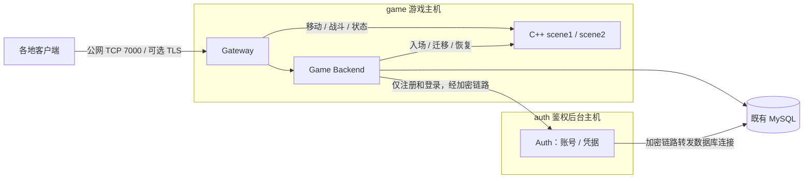

# 两机部署：游戏主机 + 鉴权后台主机

本方案将游戏实时链路集中在资源较多的主机，资源较少的主机负责账号注册与登录验证。现有桌面客户端和 TCP JSONL 协议保持兼容。本文的地址是示例，请填写自己机器的真实地址。

## 1. 职责与调用链

| 主机 | 服务 | 职责 |
| --- | --- | --- |
| `game` 游戏主机 | Gateway | 玩家 TCP/TLS 入口、连接会话、游戏请求路由、状态推送 |
| `game` 游戏主机 | Game Backend | 角色、在线会话、归属、迁移、奖励、持久化与战斗快照 |
| `game` 游戏主机 | C++ scene1 / scene2 | 权威移动、AOI、技能、怪物、伤害、死亡复活、数值热更 |
| `auth` 鉴权后台主机 | Auth | 账号名唯一性、注册、玩家 token 验证、旧账号凭据导入 |
| 既有 MySQL | 外部数据库 | 保存原角色数据及新增 `auth_accounts` 表 |

“后台”目前指账号服务及运维能力；本次没有新增网页管理后台、支付或封禁平台。数据库的物理位置继续由 `MYSQL_HOST` 等参数指定。



注册时 Auth 先保存账号并返回凭据，Game Backend 在首次成功登录时幂等创建游戏角色。旧 `roles` 中的角色 ID、名字和凭据哈希会导入 `auth_accounts`，不重新生成 token，也不重建角色。导入遇到身份冲突会停止启动，不覆盖已有账号。

会话复核、奖励、快照与场景迁移只访问游戏侧服务和原数据库。Auth 的慢请求在游戏状态锁之外执行；Auth 停止时，新注册和新登录失败，已在线会话仍可继续游戏。当前没有实时封禁/撤销凭据接口，不能把这种故障隔离理解为已经实现即时账号封禁。

## 2. 镜像与文件

当前游戏主机镜像：`webgl-20261111-v1`，Linux amd64；鉴权主机可继续使用已部署的 `game-auth-20261111-v1`。当前 Compose 还包含专用 WebGL 移动场景与网关，接入条件和协议见 [WebGL 交接](WEBGL_MOVEMENT_HANDOFF.md)。`backend` 镜像通过 `-role auth` 启动鉴权角色，默认仍启动 Game Backend。原生调试也可构建 `cmd/auth`。

| 主机 | Compose | 私有环境文件 | 项目名 |
| --- | --- | --- | --- |
| game | `deploy/game-host.compose.yaml` | `deploy/game-host.env` | `mmo-game` |
| auth | `deploy/auth-host.compose.yaml` | `deploy/auth-host.env` | `mmo-auth` |

game 拉取 backend、gateway 和 scene 镜像；auth 只拉取 backend 镜像。VPS 不编译源码。旧 `gateway-host` / `scene-host` 模板保留用于旧版本与回退，不要与新项目同时启动。

```bash
cd ~/mmo-server
git pull --ff-only origin main
# game 主机执行：
test -f deploy/game-host.env || (umask 077; cp deploy/game-host.env.example deploy/game-host.env)
# auth 主机执行：
test -f deploy/auth-host.env || (umask 077; cp deploy/auth-host.env.example deploy/auth-host.env)
```

只在相应主机创建对应文件，权限设为 `600`。保留既有 `INTERNAL_TOKEN`、数据库账号和密码。不要输出或提交实际 env，也不要运行会把完整密码展开到终端的 `compose config`；检查配置使用 `config --quiet`。

## 3. 主机间加密链路

适用于跨地域免费私网带宽不足、希望沿用现有公网套餐的部署。游戏主机主动连接鉴权主机的 SSH，建立两个转发：

| 入口 | 目标 | 用途 |
| --- | --- | --- |
| game Docker 网桥 IP `:8082` | auth `127.0.0.1:8082` | 游戏容器调用 Auth |
| auth `127.0.0.1:13306` | game 可达的 MySQL 地址 `:3306` | Auth 经公网加密链路访问既有数据库 |

MySQL 看到的来源仍为 game 主机；无需为 auth 的跨地域私网地址额外放开数据库。Auth 使用 Linux 主机网络，只监听回环地址；8082 与 13306 均不需要对公网开放。game 的转发入口绑定本机 Docker 网桥 IP，不绑定云公网映射的私网网卡。以 `ip -4 addr show docker0` 确认实际地址，避免把 8082 暴露到公网。

在 game 主机以 root 创建 `/etc/mmo-auth-link`，权限 `700`。生成专用 Ed25519 密钥，或迁移已有受限隧道密钥；私钥权限 `600`，只保留在 game 主机。把 auth 的 SSH 主机公钥通过已可信的管理连接写入 `known_hosts`，不要跳过主机身份验证。

专用公钥写入 auth 的 `authorized_keys` 时使用以下限制，替换示例公网来源；保留原管理登录公钥：

```text
from="203.0.113.10",restrict,port-forwarding,permitopen="127.0.0.1:8082",permitlisten="127.0.0.1:13306",command="/bin/false" ssh-ed25519 <专用公钥> mmo-auth-link
```

game 上 `/etc/mmo-auth-link/link.env`：

```dotenv
GAME_LINK_BIND_IP=172.17.0.1
AUTH_PUBLIC_IP=203.0.113.20
MYSQL_PRIVATE_IP=10.20.0.33
MYSQL_PRIVATE_PORT=3306
```

将 [systemd 模板](../deploy/mmo-auth-link.service.example) 安装为 `/etc/systemd/system/mmo-auth-link.service`，设置上述文件属主 root、私有权限后：

```bash
sudo systemctl daemon-reload
sudo systemctl enable --now mmo-auth-link.service
sudo systemctl is-active mmo-auth-link.service
```

服务断线自动重连。修改数据库目标地址时，除了 game 的 MySQL 参数，还要同步修改 `link.env` 的 MySQL 转发目标并重启链路，再等待 Auth 恢复健康。首次建立反向转发时，检查 auth 回环 13306 未被其他程序占用。SSH 用户示例为 root；若改用专用用户，同步修改 unit 和对应公钥文件。不要修改全局 SSH 安全设置来迁就隧道。

## 4. 配置与启动

game 环境文件填写真实 `GATEWAY_BIND_IP`、`AUTH_URL=http://游戏主机Docker网桥IP:8082` 和原 MySQL 参数。场景地址固定为同一 Docker 网络的 `scene1:9001` / `scene2:9002`；不再经过跨机 SSH 或云联网。

auth 环境文件默认 `MYSQL_HOST=127.0.0.1`、`MYSQL_PORT=13306`，其余数据库名、账号、密码与既有数据库一致。`INTERNAL_TOKEN` 与 game 相同。Auth 使用独立数据库命名锁，不能同时启动两个 Auth 写入同一个库；Game Backend 也只允许一个写入者。

规则热更：将原场景主机的整个 `deploy/combat-config/` 目录复制到 game，保留 `current.json` / `previous.json`；game env 设置 `COMBAT_CONFIG_FILE=/app/config/current.json`。保留 JSON 文件可读、目录可遍历的权限，不把配置目录改成仅 root 可读。没有原规则时先初始化，再按 [热更文档](CONFIG_HOT_RELOAD.md)设置。

从旧项目复用具名数据卷时，Compose 可能提示该卷属于旧项目；核对挂载名称仍为原卷即可，不要删除它来消除提示。

先在 auth 主机执行：

```bash
sudo docker compose --env-file deploy/auth-host.env -f deploy/auth-host.compose.yaml config --quiet
sudo docker compose --env-file deploy/auth-host.env -f deploy/auth-host.compose.yaml pull --policy always
sudo docker compose --env-file deploy/auth-host.env -f deploy/auth-host.compose.yaml up -d --no-build --pull never --wait --wait-timeout 120
sudo docker compose --env-file deploy/auth-host.env -f deploy/auth-host.compose.yaml ps
```

再在 game 主机执行：

```bash
sudo docker compose --env-file deploy/game-host.env -f deploy/game-host.compose.yaml config --quiet
sudo docker compose --env-file deploy/game-host.env -f deploy/game-host.compose.yaml pull --policy always
sudo docker compose --env-file deploy/game-host.env -f deploy/game-host.compose.yaml up -d --no-build --pull never --wait --wait-timeout 120
sudo docker compose --env-file deploy/game-host.env -f deploy/game-host.compose.yaml ps
curl --fail http://127.0.0.1:8080/readyz
```

只开放游戏入口 7000 与管理所需 SSH；8080/8081/9001/9002 在 game 仅绑定回环。公网 TCP 入口仍支持 TLS，证书参数沿用原配置。生产凭据传输应配置受信任证书；此次架构迁移不自动签发证书或更改客户端 TLS 开关。

## 5. 旧两机部署迁移顺序

这是需要短时维护的服务重新布局，不是数值热更。先完成新镜像下载，再进入维护，避免把下载时间算进停服时间。

1. 备份两台原 env、解析后的 Compose（私有保存）、隧道 unit 与授权公钥、战斗配置、旧镜像标签及 MySQL。记录角色、奖励、迁移与战斗快照数量。
2. 准备新 env 和规则目录；检查端口、MySQL可达性、镜像 revision，以及 Auth 命名锁与 Game Backend 锁互不冲突。
3. 停止原 Gateway，让断线快照落盘；原 Backend 和场景仍保持可用。核查未完成迁移，必要时恢复后再继续。
4. 对仍加载角色做最终权威快照检查与保存，随后停止原 Backend、源场景，取得静止状态数据库备份。不能把 Scene 视图中的占位金币覆盖数据库余额。
5. 停止旧场景隧道；启动新 Auth/数据库链路与 Auth，检查旧身份导入。数据库不删库、不重建原业务表。
6. 启动 game 新项目。原 Game Backend 必须已经停止，源、目标机器不能同时以相同场景 ID 接收业务。
7. 验证账号数量与原角色匹配、金币/位置/冷却快照保留、内部游戏请求同机、旧客户端可继续连接原入口。完成健康检查后再进行人工桌面体验验收。

保留原卷 `mmo-two-host-backend-data`、旧镜像、私有备份和旧 Compose。不要执行 `down -v` 或 prune。回退时先停新 Gateway/Game Backend/场景/Auth，恢复原场景部署、原隧道和原 Gateway/Backend 配置；同一时刻只启动一套游戏写入者。新架构注册但尚未首次登录的账号只存在 `auth_accounts`，回退到旧单体模式前要处理此类账号；不得直接恢复旧数据库覆盖切换后新增数据。

## 6. 日常操作

game 的数值发布明确指定新项目，避免误操作已退役的 `scene-host`：

```bash
sudo python3 scripts/combat_config.py --env-file deploy/game-host.env --compose-file deploy/game-host.compose.yaml --project-name mmo-game status
sudo python3 scripts/combat_config.py --env-file deploy/game-host.env --compose-file deploy/game-host.compose.yaml --project-name mmo-game publish configs/combat.demo.json
```

更新前先备份，修改两份 env 的发行标签，分别 pull 后启动；程序更新会重启容器。正常值热更继续不重启场景。Auth 与 Game 可分别部署，协议不兼容的更新要按发行说明协调。

隔离验收（由 GitHub Linux 构建机执行，不对实际玩家库运行）：

```bash
python3 scripts/smoke_docker.py --tag game-auth-20261111-v1 --database mysql --external-auth --hot-reload
```

覆盖注册、旧身份兼容、游戏战斗、奖励幂等、场景迁移、热更回滚、Auth 停止后的在线会话，以及 MySQL/进程重启恢复。单元测试另外验证慢鉴权不占用游戏状态锁。

全国延迟的部署选择与测量方案见 [全国玩家连接延迟](NATIONWIDE_LATENCY.md)。
