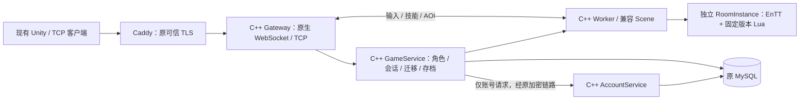

# C++ 核心服务、Lua / ECS 房间构建与切换

日期：2026-11-13。当前源码实现 C++ Gateway、AccountService、GameService，以及复用 Scene 算法的多房间 Worker、EnTT 权威存储和受限 Lua 技能编排。接口、生命周期及版本约束见 [房间交接](ROOMS_LUA_ECS.md)。旧 Go 代码保留为回归对照与回退材料。**本轮房间镜像尚待统一 CI 验证和发布，未切换两台 VPS；源码、镜像与实际运行 revision 必须分别核对。**

阶段 2 的历史 Linux amd64 候选镜像为 `ghcr.io/dravenlove/mmo-server/backend:cpp-core-20b17dbaf793`。源码 revision 为 `20b17dbaf7937cf935fb1dac130ed3691dd90af2`，当次 digest 为 `sha256:3bfea5e02734378867fbcf5e80c25b170f361f2245b6909745fec405efd62915`。[Linux CI 43407338371](https://github.com/dravenlove/mmo-server/actions/runs/43407338371) 已通过当时的构建、完整回归、普通用户容器/新卷联调和匿名拉取；另从 Windows 客户机匿名读取 manifest/config，确认同一 revision 与平台。**此镜像没有本轮 native-worker、Lua 和 EnTT 实现，不能用于更新后的房间 Compose。**

阶段 2 的两层覆盖配置使用原私有 env 中的 `MMO_NATIVE_IMAGE_TAG`；房间版在 game 另加第三层覆盖和独立 `MMO_ROOM_IMAGE_TAG`。保留原场景、Auth 与 Go 回退标签，不把历史 cpp-core 标签填作房间标签。先按本文维护流程备份、停旧写入者再切换，不能把拉取镜像视为已上线。

## 本次范围



核心服务均为真实 C++ 实现，不把玩家请求代理回 Go。旧 JSON、五种 Gateway profile（full、movement、abilities、elemental、skill_lab）、四个浏览器入口、原永久 token、bcrypt 密码、新登录票据和原 MySQL 数据继续使用。客户端不使用组房功能时无需新增命令；没有修改 Unity 工程。

本轮已实现房间 create/join/ready/start/finish/leave、逐房间权威实体隔离、Lua 弹道/墙体生成计划、脚本版本与 SHA 固定，以及先存档再回收。Worker 的默认 `/v1/*` 保留旧 Scene 模式与热更接口；动态房间使用 `/rooms/{id}/v1/*`，数值和脚本在创建时固定。共享房间支持 movement/combat/abilities/skill_lab，elemental 个人试炼继续原协议。自动匹配、跨 Worker 调度、通用 Buff/怪物脚本、Protobuf 和安全 KCP 仍未实现；不能把语言或存储迁移视为已经解决公网或客户端表现延迟。

| 新产物 | 入口 | 替换对象 |
| --- | --- | --- |
| `native-gateway` | `native/gateway/` | Go Gateway 与自研 Go WebSocket bridge |
| `native-account` | `native/account/` | Go Auth |
| `native-game-service` | `native/game_service/` | Go Backend |
| `native-db` | `native/persistence/` | MySQL / SQLite 预处理、事务与写入者锁 |
| `native-worker` | `native/room/`、`scene/src/ecs_storage.hpp` | 默认兼容 Scene 和多房间 EnTT 权威状态 |
| `native-script`（库） | `native/script/`、`scripts/gameplay/` | 预算 Lua 5.4 VM、可信技能计划与版本归档 |

发布复用既有公开 `backend` 镜像包，C++ 程序放在同一镜像，由 Compose `entrypoint` 选择。阶段 2 使用 `cpp-core-…`，当前工作流的房间版默认命名为 `cpp-room-<源码提交前12位>`；后者此时只是命名规则，实际可用标签和 digest 须等待统一 CI 发布并记录，见 [验证记录](VALIDATION.md)。原 Go Backend 标签不变。核心覆盖层可用 `MMO_NATIVE_IMAGE_NAME` 改包名，房间第三层固定使用原前缀的 `backend` 包。本机 Docker 演示使用镜像内 Worker；生产只替换 scene-skills，其他五个 Scene 标签独立保留。Go 仍可用于诊断 CLI、回归夹具和运维。

## 构建与验证

迁移源码位于 `codex/cpp-stack-migration`，审阅入口是 [PR #1](https://github.com/dravenlove/mmo-server/pull/1)。尚未合并时，`main` 不包含这些文件。新目录可直接 `git clone --branch codex/cpp-stack-migration https://github.com/dravenlove/mmo-server.git mmo-server-cpp`；已有目录先核对 `git status`，再 fetch/switch 对应分支，不覆盖本地修改或私有 env。

新服务目标环境为 Linux amd64。Windows 使用 Docker 的 Linux 引擎或独立 Ubuntu WSL 环境。依赖 C++17、Boost 1.83（Ubuntu 24.04）、OpenSSL 3、SQLite3、MariaDB Connector/C、libcrypt 和系统 Lua 5.4；Connector/C 只是客户端库，服务端仍要求 MySQL >= 8.0.16，拒绝 MariaDB Server。EnTT v3.13.2、JSON/HTTP 头文件及许可证由 [第三方依赖清单](../third_party/README.md)固定。Lua 构建安装 `liblua5.4-dev`，运行镜像安装 `liblua5.4-0`，不使用 LuaJIT。

Ubuntu 构建机安装依赖后运行：

```bash
sudo apt-get update
sudo apt-get install -y build-essential cmake pkg-config libboost-system-dev \
  libssl-dev libsqlite3-dev libmariadb-dev libcrypt-dev liblua5.4-dev python3 golang-go \
  mysql-server-core-8.0 mysql-client-core-8.0
cmake -S native -B build/native -DCMAKE_BUILD_TYPE=Debug
cmake --build build/native --parallel 2
ctest --test-dir build/native --output-on-failure
python3 scripts/test_native_stack.py --build build/native --scene build/native/scene-core/scene-server
python3 scripts/test_native_legacy.py --build build/native --scene build/native/room/native-worker
python3 scripts/test_room_stack.py --build build/native
python3 scripts/test_native_mysql.py --build build/native
```

最后一条命令启动独立随机端口、临时目录中的 MySQL，结束后退出并清理；不读取部署 env，也不使用现网数据库。包含无 DELETE 权限、Go/C++ 密码互认、原锁名竞争、锁连接被 KILL 后停止写入、静止 UPDATE 匹配行数和 Backend 故障恢复测试。运行账号需要能初始化自己的 mysqld；CI 的系统 MySQL 可保持原状。

原生根构建同时构建 Scene、Lua 与 Worker，不必重复配置 Scene。`test_native_legacy.py` 用 Worker 的默认场景运行旧 smoke，在临时源码副本执行，避免覆盖开发机已有 `bin/`；`test_room_stack.py` 验证新组房链路。Go 仅作为诊断客户端与测试夹具，新网关/后台/场景均为 C++。命令清单不是已通过记录，当前结果见 [VALIDATION.md](VALIDATION.md)；本地协议探针通过不等于真实 Unity 页面画面、全国网络或容量验收。

## 本机 Docker 联调

单独创建权限受限的测试 env，写入随机 `INTERNAL_TOKEN`。该值用于服务之间认证，不给 Unity 客户端。`NATIVE_ALLOWED_ORIGINS` 填**实际测试页面的 Origin**，例如 `http://localhost:8088`，不填 WebSocket URL。

```bash
python3 scripts/init_native_env.py --origin http://localhost:8088
docker compose --env-file deploy/native-local.env -f deploy/native-local.compose.yaml build
docker compose --env-file deploy/native-local.env -f deploy/native-local.compose.yaml up -d --wait
curl --fail http://127.0.0.1:18080/readyz
```

测试 WebSocket：`ws://127.0.0.1:17001/ws`；TCP：`127.0.0.1:17000`。这是回环地址上的独立 skill_lab 默认场景、可选动态房间与两个 SQLite 测试卷，不使用 VPS 原账号。scene 服务现运行 native-worker，Backend 自动配置内部 `ROOM_WORKER_URL`。HTTPS 网页不能连接明文 ws；真实 HTTPS/WebGL 验收仍经可信 TLS。停止使用 `down` 即可，不默认删除测试卷。

当前房间源码先使用上面的本机构建流程。待本轮 CI 发布后，才可在 `deploy/native-local.env` 设置 `MMO_IMAGE_PREFIX=ghcr.io/dravenlove/mmo-server`、`MMO_NATIVE_IMAGE_NAME=backend`、`MMO_NATIVE_IMAGE_TAG=<已验证的 cpp-room 标签>`，再用该 Compose `pull` 与 `up -d --no-build --pull never --wait` 省去构建。这里本机变量仍叫 `MMO_NATIVE_IMAGE_TAG`，生产房间第三层变量才是 `MMO_ROOM_IMAGE_TAG`。四个本机服务共用镜像；不要填历史 cpp-core 标签，也不要连接真实业务库试验。

## 两台 VPS 核心服务切换规则（阶段 2）

不要在小规格 VPS 编译。两层覆盖文件用于切换 C++ 核心服务；可选择前述历史阶段 2 镜像，房间功能则必须另按下一节叠加第三层。保留原 `MMO_IMAGE_TAG`、`MMO_GATEWAY_IMAGE_TAG`、`MMO_BACKEND_IMAGE_TAG`、`MMO_SKILL_LAB_IMAGE_TAG`，新增经验证的 `MMO_NATIVE_IMAGE_TAG`。生产 override 默认复用公开 backend 包；本机默认构建的 `mmo/native:dev` 不是公开镜像。

使用 Docker Compose >= 2.24.4（override 用 `!reset` 清除旧 Go build）。配置校验和拉镜像不切换服务：

```bash
# game 主机，使用原 game-host.env（追加新标签与原精确 Origin 白名单）
sudo docker compose --env-file deploy/game-host.env \
  -f deploy/game-host.compose.yaml -f deploy/native-game.override.yaml config --quiet
sudo docker compose --env-file deploy/game-host.env \
  -f deploy/game-host.compose.yaml -f deploy/native-game.override.yaml pull backend gateway gateway-webgl gateway-combat gateway-elemental gateway-skills

# auth 主机，使用原 auth-host.env（追加同一已验证新标签）
sudo docker compose --env-file deploy/auth-host.env \
  -f deploy/auth-host.compose.yaml -f deploy/native-auth.override.yaml config --quiet
sudo docker compose --env-file deploy/auth-host.env \
  -f deploy/auth-host.compose.yaml -f deploy/native-auth.override.yaml pull auth
```

切换由一个负责人执行，顺序为：

1. 读取正在运行的镜像 revision、实际 Compose project、挂载、原加密链路和 TLS 配置。核对私有备份和数据基线，不能把历史角色总数当固定值。
2. 提示维护窗口，停止五个旧 Gateway，等待最终 disconnect/checkpoint 排空，再停止旧 Backend；这一步会断开现有连接。
3. 备份一致的业务库，核对账号、稳定 token 哈希、金币、战斗快照和未决迁移。数据库密码由现有受限配置交给备份工具，不打印、不放命令参数。
4. auth 主机停止旧 Auth，确认它释放 `mmo-auth:` 命名锁，再用 override 启动 C++ Auth。先测健康与受控账号；不能同时运行两个 Auth 写入者。
5. game 主机用 override 启动 C++ Backend，获取原 `mmo-backend:` 锁，再核对旧角色、快照与迁移恢复。旧 Scene 不重启。
6. 停止占用 `7001/7004/7006/7008` 的四个旧宿主机 bridge；启动五个 C++ Gateway。override 保持原 TCP 端口，新增回环 WebSocket 端口，Caddy 路由继续使用原地址。原 SSH 服务和数据库转发不改。
7. 逐项验证四个可信 WSS 入口、原精确 Origin、旧/新账号、双角色技能、会话替换、断线重连和真实 Unity 页面。核对写入者、revision、数据变化与重启计数后才结束维护。

**原生 TCP 直连 TLS 的边界：**本版本在 `TLS_CERT_FILE` / `TLS_KEY_FILE` 非空时拒绝启动，要求受信任入口终止 TLS。override 不清空原 TLS 配置；若原 7000 端口使用直连 TLS，先保持旧 Gateway，单独提供等价 TLS 代理并验收，不能通过删证书变量降级为明文。浏览器的 Caddy WSS 可继续复用。

MySQL 数据库名目前要求 ASCII，避免跨语言大小写规范化导致锁名不同；不支持的配置启动时明确拒绝，不创建另一套空库替代。MySQL 必须沿用旧账号权限；普通登录不需要 DELETE。SQLite Auth 与 Backend 的本地锁文件分别为 `.auth.lock` / `.lock`，旧 Go Auth 没有等价 SQLite 进程锁，所以混用时仍必须串行停启。

## game 的房间覆盖层（本轮新增，尚未上线）

前提是统一 CI 成功发布房间镜像，核对 revision、Linux amd64 平台、digest 与匿名拉取后，才在原 `deploy/game-host.env` 追加 `MMO_ROOM_IMAGE_TAG=<已验证标签>`。此处不提供未经发布的具体标签。保留已有 `MMO_NATIVE_IMAGE_TAG` 供第二层及独立 Auth 使用，保持实际数据库地址、密码、INTERNAL_TOKEN、旧 Origin、数据卷和入口配置。

第三层只更换 game 的 Backend、五个 Gateway 与 scene-skills。Auth 不在该文件中，其他五个 Scene 不换标签；旧客户端仍可访问原默认场景。配置校验与拉取可以先做，运行切换仍按上一节维护窗口、单写入者及备份顺序执行：

```bash
sudo docker compose --env-file deploy/game-host.env \
  -f deploy/game-host.compose.yaml -f deploy/native-game.override.yaml \
  -f deploy/native-room-game.override.yaml config --quiet
sudo docker compose --env-file deploy/game-host.env \
  -f deploy/game-host.compose.yaml -f deploy/native-game.override.yaml \
  -f deploy/native-room-game.override.yaml pull \
  backend gateway gateway-webgl gateway-combat gateway-elemental gateway-skills scene-skills
```

维护时停止旧 Gateway 并等待最终保存，停止旧 Backend；备份一致数据库后，再停止需替换的 scene-skills。先用同一组三层文件启动 `scene-skills backend` 并检查恢复与写入者锁，再启动五个 Gateway。启动使用 `up -d --no-build --pull never --wait` 并明确列出服务；不启动另一套并行 Backend。原 Auth、其他 Scene、TLS 与 SSH 链路继续使用各自配置。

脚本以只读卷挂载到 `/app/gameplay`，默认来源是仓库 `scripts/gameplay`，可通过 `ROOM_GAMEPLAY_DIR` 指定可信归档目录。保留 active manifest、`versions/<version>.json` 与历史源码；不能只留最新版。发布/状态命令见 [房间交接](ROOMS_LUA_ECS.md)。新房间固定 version + SHA 和创建时数值配置；运行中的房间不会被 reload 改成新规则。Worker 重启恢复已存角色并创建新世界、回到 lobby，不是整局战斗无损恢复。

业务验收需覆盖旧账号/永久 token、金币与快照、四种旧 WSS、两个账号组房、准备与房主开局、弹道/墙体隔离、断线重连、结束/离开及旧请求围栏。单独记录真实 Unity 页面和网络结果；本文件没有执行 VPS 更新。

## 回退

**从房间版回退到阶段 2 或 Go Backend 前，必须先排空。**旧 Backend 不认识 `room-…` 归属，不能直接换镜像。先进入维护、停止新组房并停止玩家 Gateway、等最终保存；保持当前 Backend 与 Worker 运行，反复执行：

```bash
sudo python3 scripts/room_admin.py drain --env-file deploy/game-host.env
```

工具读取受限 env，不把密钥放进命令行。每次处理有 10 秒/32 项预算；只有返回 `complete:true`，剩余动态归属和未决迁移均为 0，才停止当前 Backend/Worker 并退回旧配置。失败应恢复依赖或归档脚本后重试，不能清库强行退回。排空会旋转会话并让离线角色保存后回静态场景。

不涉及动态房间的核心服务回退，先停止 C++ Gateway，等待最终存档，再停 C++ Backend。Auth 回退时单独停 C++ Auth 后再启动旧 Auth。使用原 Compose 文件及此前记录的原标签启动旧服务，最后按实际入口恢复原四个 bridge。不能让新旧业务写入者并行，也不能用 `down -v`、`prune` 或旧 SQL 备份覆盖切换后的新数据。

旧账号、角色、资产和战斗存档结构继续兼容；房间版增加房间目录、返回信息与恢复意图，不需要重注册、批量改密码或清空角色，也不增加 DELETE 权限要求。排空后旧代码可忽略新增房间元数据，回退不删除这些表。若数据核对或恢复失败，保持入口关闭，读取具体错误后处理；不要把“健康检查 200”替代业务和数据验收。
