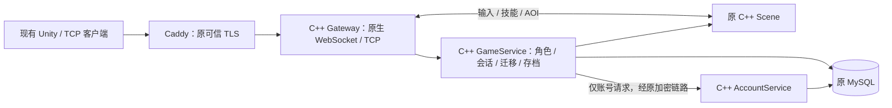

# C++ 核心服务迁移与联调

日期：2026-11-13。此版本实现 C++ Gateway、AccountService 和 GameService，复用既有 C++ Scene。旧 Go 代码保留为回归对照与回退材料。**本文的源代码实现不代表现网已切换；运行版本仍需读取容器 revision。**

## 本次范围



三个新进程均为真实 C++ 实现，不把玩家请求代理回 Go。旧 JSON、五种 Gateway profile（full、movement、abilities、elemental、skill_lab）、四个浏览器入口、原永久 token、bcrypt 密码、新登录票据和原 MySQL 表继续使用。客户端此次无需改协议，也没有修改 Unity 工程。

本次先完成迁移方案的核心服务替换。Lua/ECS 房间内核、房间匹配、新 Protobuf 协议和安全 KCP 入口属于后续独立阶段，**本版本没有提供这些能力**。当前场景算法与 Tick 沿用原实现，不能把换成 C++ 视为已经解决公网或客户端表现延迟。

| 新产物 | 入口 | 替换对象 |
| --- | --- | --- |
| `native-gateway` | `native/gateway/` | Go Gateway 与自研 Go WebSocket bridge |
| `native-account` | `native/account/` | Go Auth |
| `native-game-service` | `native/game_service/` | Go Backend |
| `native-db` | `native/persistence/` | MySQL / SQLite 预处理、事务与写入者锁 |

新镜像名是 `<原镜像前缀>/native:<已验证的新标签>`，三个程序放在同一镜像，由 Compose `entrypoint` 选择。六个场景的原镜像标签独立保留。Go 仍可用于诊断 CLI、回归夹具和运维；未切换的旧部署当然仍运行 Go 服务。

## 构建与验证

新服务目标环境为 Linux amd64。Windows 使用 Docker 的 Linux 引擎或独立 Ubuntu WSL 环境。C++17、Boost 1.83（Ubuntu 24.04）、OpenSSL 3、SQLite3、MariaDB Connector/C 与 libcrypt；Connector/C 只是客户端库，服务端仍要求 MySQL >= 8.0.16，拒绝 MariaDB Server。现有 JSON/HTTP 头文件仍由 `third_party/README.md` 固定。

Ubuntu 构建机安装依赖后运行：

```bash
sudo apt-get update
sudo apt-get install -y build-essential cmake pkg-config libboost-system-dev \
  libssl-dev libsqlite3-dev libmariadb-dev libcrypt-dev python3 golang-go \
  mysql-server-core-8.0 mysql-client-core-8.0
cmake -S native -B build/native -DCMAKE_BUILD_TYPE=Debug
cmake --build build/native --parallel 2
ctest --test-dir build/native --output-on-failure
cmake -S scene -B build/scene-native -DCMAKE_BUILD_TYPE=Release
cmake --build build/scene-native --parallel 2
ctest --test-dir build/scene-native --output-on-failure
python3 scripts/test_native_stack.py --build build/native --scene build/scene-native/scene-server
python3 scripts/test_native_legacy.py --build build/native --scene build/scene-native/scene-server
python3 scripts/test_native_mysql.py --build build/native
```

最后一条命令启动独立随机端口、临时目录中的 MySQL，结束后退出并清理；不读取部署 env，也不使用现网数据库。包含无 DELETE 权限、Go/C++ 密码互认、原锁名竞争、锁连接被 KILL 后停止写入、静止 UPDATE 匹配行数和 Backend 故障恢复测试。运行账号需要能初始化自己的 mysqld；CI 的系统 MySQL 可保持原状。

`test_native_legacy.py` 在临时源码副本运行原 smoke 脚本，避免覆盖开发机已有 `bin/`。Go 仅作为诊断客户端与测试夹具，新网关/后台/场景均为 C++。本地协议探针通过不等于真实 Unity 页面画面、全国网络或容量验收。

## 本机 Docker 联调

单独创建权限受限的测试 env，写入随机 `INTERNAL_TOKEN`。该值用于服务之间认证，不给 Unity 客户端。`NATIVE_ALLOWED_ORIGINS` 填**实际测试页面的 Origin**，例如 `http://localhost:8088`，不填 WebSocket URL。

```bash
python3 scripts/init_native_env.py --origin http://localhost:8088
docker compose --env-file deploy/native-local.env -f deploy/native-local.compose.yaml build
docker compose --env-file deploy/native-local.env -f deploy/native-local.compose.yaml up -d --wait
curl --fail http://127.0.0.1:18080/readyz
```

测试 WebSocket：`ws://127.0.0.1:17001/ws`；TCP：`127.0.0.1:17000`。这是回环地址上的独立 skill_lab 场景与两个 SQLite 测试卷，不使用 VPS 原账号。HTTPS 网页不能连接明文 ws；真实 HTTPS/WebGL 验收仍经可信 TLS。停止使用 `down` 即可，不默认删除测试卷。

## 两台 VPS 切换规则

不要在小规格 VPS 编译。先由 `Native C++ stack` 工作流完成回归和 Linux 镜像构建，选择全新的、已成功发布且匿名可拉取的标签。保留原 `MMO_IMAGE_TAG`、`MMO_GATEWAY_IMAGE_TAG`、`MMO_BACKEND_IMAGE_TAG`、`MMO_SKILL_LAB_IMAGE_TAG`，只新增 `MMO_NATIVE_IMAGE_TAG`。禁止把本地 `mmo/native:dev` 当成公开镜像。

使用 Docker Compose >= 2.24.4（override 用 `!reset` 清除旧 Go build）。配置校验和拉镜像不切换服务：

```bash
# game 主机，使用原 game-host.env（追加新标签与原精确 Origin 白名单）
sudo docker compose --env-file deploy/game-host.env \
  -f deploy/game-host.compose.yaml -f deploy/native-game.override.yaml config --quiet
sudo docker compose --env-file deploy/game-host.env \
  -f deploy/game-host.compose.yaml -f deploy/native-game.override.yaml pull backend gateway gateway-webgl gateway-combat gateway-elemental gateway-skills

# auth 主机，使用原 auth-host.env（追加同一已验证新标签）
sudo docker compose --env-file deploy/auth-host.env \
  -f deploy/auth-host.compose.yaml -f deploy/native-auth.override.yaml config --quiet
sudo docker compose --env-file deploy/auth-host.env \
  -f deploy/auth-host.compose.yaml -f deploy/native-auth.override.yaml pull auth
```

切换由一个负责人执行，顺序为：

1. 读取正在运行的镜像 revision、实际 Compose project、挂载、原加密链路和 TLS 配置。核对私有备份和数据基线，不能把历史角色总数当固定值。
2. 提示维护窗口，停止五个旧 Gateway，等待最终 disconnect/checkpoint 排空，再停止旧 Backend；这一步会断开现有连接。
3. 备份一致的业务库，核对账号、稳定 token 哈希、金币、战斗快照和未决迁移。数据库密码由现有受限配置交给备份工具，不打印、不放命令参数。
4. auth 主机停止旧 Auth，确认它释放 `mmo-auth:` 命名锁，再用 override 启动 C++ Auth。先测健康与受控账号；不能同时运行两个 Auth 写入者。
5. game 主机用 override 启动 C++ Backend，获取原 `mmo-backend:` 锁，再核对旧角色、快照与迁移恢复。旧 Scene 不重启。
6. 停止占用 `7001/7004/7006/7008` 的四个旧宿主机 bridge；启动五个 C++ Gateway。override 保持原 TCP 端口，新增回环 WebSocket 端口，Caddy 路由继续使用原地址。原 SSH 服务和数据库转发不改。
7. 逐项验证四个可信 WSS 入口、原精确 Origin、旧/新账号、双角色技能、会话替换、断线重连和真实 Unity 页面。核对写入者、revision、数据变化与重启计数后才结束维护。

**原生 TCP 直连 TLS 的边界：**本版本在 `TLS_CERT_FILE` / `TLS_KEY_FILE` 非空时拒绝启动，要求受信任入口终止 TLS。override 不清空原 TLS 配置；若原 7000 端口使用直连 TLS，先保持旧 Gateway，单独提供等价 TLS 代理并验收，不能通过删证书变量降级为明文。浏览器的 Caddy WSS 可继续复用。

MySQL 数据库名目前要求 ASCII，避免跨语言大小写规范化导致锁名不同；不支持的配置启动时明确拒绝，不创建另一套空库替代。MySQL 必须沿用旧账号权限；普通登录不需要 DELETE。SQLite Auth 与 Backend 的本地锁文件分别为 `.auth.lock` / `.lock`，旧 Go Auth 没有等价 SQLite 进程锁，所以混用时仍必须串行停启。

## 回退

停止 C++ Gateway，等待最终存档，再停 C++ Backend；Auth 回退时单独停 C++ Auth 后再启动旧 Auth。使用原 Compose 文件及此前记录的原标签启动旧服务，最后恢复原四个 bridge。不能让新旧业务写入者并行，也不能用 `down -v`、`prune` 或旧 SQL 备份覆盖切换后的新数据。

这次迁移保持原表结构，不需要重新注册、批量改密码或清空角色。若数据核对或恢复失败，保持入口关闭，读取具体错误后处理；不要把“健康检查 200”替代业务和数据验收。
