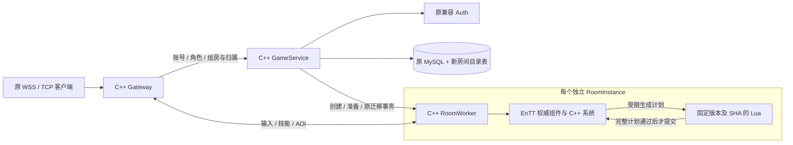
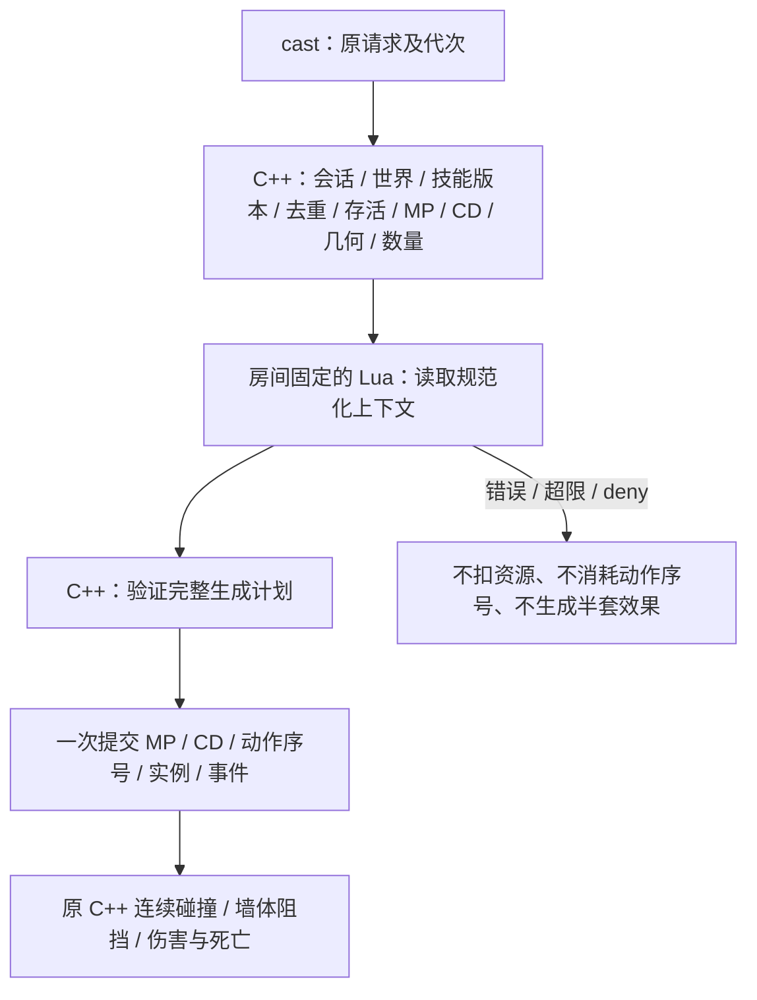

# Lua / ECS 房间系统与客户端兼容

2026-11-13。此版本在 C++ 核心迁移上增加真实 ECS 权威存储、可信 Lua 技能编排及多房间 Worker。账号、永久 token、密码、金币和旧 JSON 入口不重建。源码、镜像与现网运行版本分别记录，实际验收见 [VALIDATION.md](VALIDATION.md)；本文件不代表已切换两台 VPS。

## 调用链与职责



Worker 的单条逻辑执行流串行推进各房间，网络线程只投递有界命令。每房间独立 Scene、EnTT registry、世界代次、Tick、事件、弹道、墙体及脚本引用。玩家、元素候选角色、NPC、弹道和墙体直接存于组件池；排序索引只存实体句柄，沿用旧确定性遍历顺序和稳定引用。玩家状态目前是聚合组件，尚未把 Transform/Combat/SkillBook 每个字段拆成独立组件；没有第二份每 Tick 同步的战斗状态镜像。

Auth 只处理账号，实时房间留在 game。Go 旧服务和 CLI 保留作回归、运维与回退材料。此次没有改 Unity 工程，也没有启动客户端云构建。

## 旧协议与可选房间命令

原 `/ws`、`/combat/ws`、`/elemental/ws`、`/skills/ws` 以及 TCP JSONL 的登录、移动、技能、状态字段继续使用。Worker 的 `/v1/*` 是兼容默认场景，原客户端不发任何房间命令也能联调。

以下命令仅在新 C++ Gateway 且 Backend 配置 `ROOM_WORKER_URL` 后可用。每帧仍为 `{id,op,...}`，回执匹配 id，可穿插 state。玩法取当前 Gateway profile，客户端不能选服务器脚本文件或上传 Lua。`full` 对应 combat 房，movement/abilities/skill_lab 各自独立；elemental 的原个人试炼协议保持，不混入共享组房。跨玩法入口重新登录会安全返回对应静态大厅，同玩法重连保留房间。

| op | 客户端字段 | 行为 |
| --- | --- | --- |
| `room_create` | `request_id`，可选 `capacity` | 创建房间，默认 4 人，允许 1～16；返回服务端生成的 room_id |
| `room_list` | 无 | 同 profile 未结束房间的持久目录；实时人数用 status 查询 |
| `room_status` | 可选 `room_id` | 查询元数据，省略时使用当前房间 |
| `room_join` | `room_id,request_id` | 原场景冻结、目标准备、SQL 归属提交、激活及源清理 |
| `room_ready` | `ready:bool` | 当前成员准备或取消；过期连接不能充当已准备玩家 |
| `room_start` | 无 | 房主且全部在线成员准备后开局 |
| `room_finish` | 可选 `room_id` | 房主结束；创建者可从房间外关闭自己的空房 |
| `room_leave` | `request_id`，建议 `room_id` | 返回入房前静态场景，保留身份与资产；重复请求不重复迁移 |

`request_id` 是 1～128 字节稳定业务重试 ID。未知结果应复用原 ID 和原参数；改目标/容量须换 ID。会话、角色与 owner 从认证连接派生，不能提交 `role_id`、`session_epoch` 或管理授权标记。重放完成的 join/leave 可用原 owner，新的操作必须匹配当前归属。默认限制为全局 16 个未结束目录、每创建者 4 个，属于保护阈值而非承载保证。

```json
{"id":"create-1","op":"room_create","request_id":"party-demo-1","capacity":2}
```

收到 room_id 后发送 join，再 ready/start。join/leave 回执沿用角色 JSON；`view/state` 顶层增加 `room` 元数据，包含 `room_id,state,host_role_id,members,script_version,script_sha256,world_epoch,revision`。`lobby` 可观察、注册技能和准备，移动/施法在开局前拒绝；`playing` 推进原战斗；`finished` 停止战斗，允许安全离开和存档确认。客户端若做组房 UI，需要自行处理这些新增命令；旧客户端兼容不等于已有组房 UI。

## Lua 技能执行

保留原 `skill_init`：客户端提交合法技能 ID 与完整弹道/墙体参数，C++ 校验范围和版本。`cast` 的执行顺序为：



首版宿主 API 为 `host.emit(type,skill_id)` 与 `host.deny(reason)`。每次最多一个 canonical 弹道或墙体意图，必须与该玩家已注册定义匹配，具体数值仍由 C++ 按客户端注册定义生成。没有 Lua 任意扣血、改金币、调用数据库或直接修改别的房间实体的能力；近战等其他旧玩法仍用原 C++ 实现。

默认模块在 `scripts/gameplay/skills_v1.lua`。Lua 5.4 每次调用重建预算 VM，房间持有不可变源码版本，不让模块全局变量或失败调用泄漏到下一次或另一房间；持续玩法状态应存 ECS。默认 1 MiB 分配额、50,000 指令、16 次暴露宿主调用、源码 64 KiB、上下文 8 KiB，另有深度/字符串/输出限制。没有 io/os/package/debug、任意 load、随机源或可绕过预算的长耗时库接口。它是可信服务端脚本接口，不是开放客户端代码沙盒。

## 发布脚本与重启

每个房间绑定 `version + sha256`，Backend 同时持久化两者；同名源码变更会拒绝恢复，不会悄悄切换。`manifest.json` 指向当前新房版本；`versions/<version>.json` 与旧源码必须保留供重启恢复。文件只能是配置脚本目录内的常规文件，拒绝目录、FIFO、越界路径和校验失败。

发布步骤：写入新的 Lua 文件及其 SHA，创建新的不可变版本 manifest，原子替换 active manifest，再在 game 主机运行：

```bash
sudo python3 scripts/room_admin.py reload --env-file deploy/game-host.env
sudo python3 scripts/room_admin.py status --env-file deploy/game-host.env
```

工具只读取私有 env 中的 INTERNAL_TOKEN，不放进命令参数或输出，也不跟随重定向。reload 仅从服务器已配置的 manifest 读取；现有房间保持旧脚本，后来创建的房间使用新脚本。动态房间拒绝中途修改 combat config，默认兼容场景保留原数值热更接口。没有宣称活动对局内任意代码热换。

Worker 重启后，目录仍在原数据库，Backend 按原版本与 SHA 重建房间、恢复已存角色；临时弹道、墙体、准备状态与未存战斗进度不作完整恢复。每角色绑定房间世界代次，重建后旋转会话，迟到的旧移动、施法和检查点不能写入新世界；Backend 控制请求另带私有世界围栏。客户端看到新 world_epoch 后按旧协议重新读取状态与初始化技能。房间重新回到 lobby，需要再次准备开局；不是整局无损高可用。

## 存档、回收与回退

新表仅 `rooms_directory`、`room_returns`；沿用原 Backend 固定连接命名锁、事务与角色迁移日志，不修改旧账号哈希或要求 DELETE 权限。

断线不等于保存成功。结束房间先取得最终权威角色并提交 SQL，再异步发精准 `persisted` 确认；Worker 仅对同房间、相同 owner/session、离线/租约到期且位置/战斗快照完全一致的记录移除实体。失败、过期确认或队列满都保留缓存。只有没有角色和未决准备的房间才回收；不会按断线时间盲删未保存 HP。结束房间重连或排空使用原迁移事务，已回收空房的回大厅过程也有持久 COMMITTED 意图，可在故障后继续。

回退到没有房间支持的旧 Backend 前，必须先停止新组房并排空动态角色。旧服务不认识持久化的 `room-…` 路由，直接换旧镜像会使这些角色暂时无法入场。维护期间反复执行：

```bash
sudo python3 scripts/room_admin.py drain --env-file deploy/game-host.env
```

每次有 10 秒/32 项预算；只有 `complete:true`、剩余动态归属与未决迁移均为 0 才可继续回退。若失败先恢复依赖或归档脚本再重试，不清库、不覆盖旧 SQL 备份，不让新旧 Backend 同时写。排空会使旧会话失效，离线角色同样保存后回静态场景。

## Docker 运行

本机入口仍是 `native-local.compose.yaml`，现在 scene 服务使用 native-worker，Backend 自动配置内部 Worker URL，独立测试卷不连真实数据库。两台 VPS 的可选 game 覆盖层为：

```bash
sudo docker compose --env-file deploy/game-host.env \
  -f deploy/game-host.compose.yaml -f deploy/native-game.override.yaml \
  -f deploy/native-room-game.override.yaml config --quiet
```

设置经验证的 `MMO_ROOM_IMAGE_TAG` 后先 pull；维护窗口中备份并串行切换 Backend/Gateway/scene-skills。Auth 和其他五个旧 Scene 标签保留。脚本目录以只读卷挂载，默认仓库 `scripts/gameplay`，可用 `ROOM_GAMEPLAY_DIR` 指定服务端归档目录。实际发布标签与验证证据见 [VALIDATION.md](VALIDATION.md)，不要把阶段 2 的 cpp-core 标签当作已有 native-worker。
