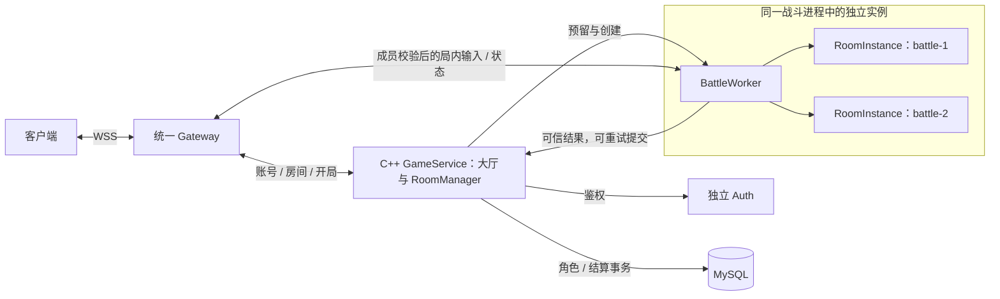
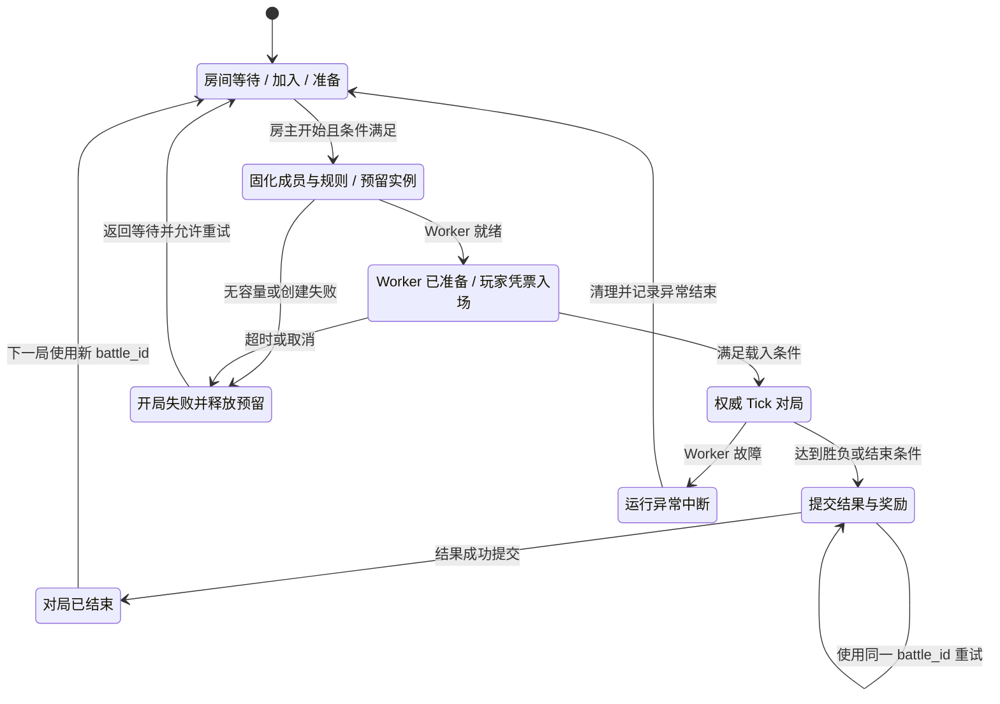

# 房间制多人游戏架构参考与本项目建议

日期：2026-11-13（Asia/Shanghai）。状态：公开资料研究与设计建议，**尚未实施，不代表现网已支持创建/加入多人房间**。现有运行版本仍以 [项目协作记忆](AGENT_MEMORY.md) 为准。

建议先明确为“大厅 + 房间 + 独立对局 + 长期角色数据”的房间制多人游戏；若以后需要公共城镇或持久世界，再增加地图/分线服务。用户后续已选择 C++ 玩家网关和游戏业务、Lua 玩法、Go 运维的目标，见 [C++ 技术栈迁移](CPP_STACK_MIGRATION.md)。下述房间职责按该目标描述，当前运行实现仍是旧 Go + C++。

## 1. MMO 和房间制分别解决什么

| 形态 | 游戏世界生命周期 | 需要重点解决 |
| --- | --- | --- |
| 持久世界型 MMO | 地图/分线长期存在，玩家持续进入和离开 | 地图容量、AOI、跨地图迁移、世界状态和长期经济 |
| 房间制对局 | 每局有成员、开始和结束，局内世界可独立回收 | 组队、准备、分配对战实例、入场、断线重连、结算 |
| 公共区域 + 实例副本 | 公共区域长期运行，副本按队伍或任务创建 | 两类生命周期并存、入副本/回城、角色快照及奖励一致性 |

上表是架构分类，不代表某款商业游戏的全部内部实现。对于目前的技能对战/双客户端联调，优先完成第二类更容易形成完整可玩的循环。

## 2. 可直接参考的公开做法

| 官方公开方案 | 已公开的机制 | 可借鉴到本项目的部分 |
| --- | --- | --- |
| [Steam Matchmaking & Lobbies](https://partner.steamgames.com/doc/features/multiplayer/matchmaking) | Lobby 保存成员、设置和准备阶段信息；开局后玩家连接游戏服务器或指定玩家 Host | 大厅房间与实时战斗分开，房间成员、规则和开局流程明确 |
| [Photon Fusion Matchmaking](https://doc.photonengine.com/fusion/v2/manual/connection-and-matchmaking/matchmaking) | Lobby 用于列出 Session；Session 有属性、人数上限、可见性及是否开放加入等信息 | 房间列表、地图/模式筛选、公开/私有房、人数和中途加入策略 |
| [Amazon GameLift Servers](https://docs.aws.amazon.com/gameliftservers/latest/developerguide/gamelift-howitworks.html) | Backend 协调会话请求，分配可用游戏服并交付连接信息，游戏服承载实际对局 | 将“分组/房间”“选择 Worker”“运行对局”作为不同职责；不把游戏循环放进登录服务 |
| [Nakama Authoritative Multiplayer](https://heroiclabs.com/docs/nakama/concepts/multiplayer/authoritative/) | 权威对局有初始化、入场检查、加入/离开、Tick 和结束回调，各对局有独立内存状态 | 每局一个 RoomInstance/Match 对象，明确生命周期、输入校验、独立状态和广播范围 |
| [Riot：VALORANT 网络设计](https://www.riotgames.com/en/news/peeking-valorants-netcode) | 服务端保存权威游戏状态，客户端做移动预测，发生偏差时接受纠正 | 实时 PvP 的命中/伤害由服务端决定，响应手感还需要预测和纠正配合 |
| [Agones 高密度 GameServer](https://agones.dev/site/docs/integration-patterns/high-density-gameservers/) | 同一游戏服务器进程可承载多个并发 Session，需要管理其容量和生命周期 | 一个房间不必对应一个 Docker 容器；轻量战斗可以先采用一进程多房间 |

这些产品和案例公开的是不同层面的能力，不能直接等同于某款游戏的完整架构，也不表示本项目必须购买或引入它们。

不同产品的 Lobby 命名有差异：Steam 的 Lobby 可以是准备开局的成员组，Photon 的 Lobby 主要是 Session 列表。本文统一把入口和列表称为“大厅”，成员组队称为“房间”，实际运行的一局称为“对局实例”，接 SDK 时需对照其定义。

## 3. 三个容易混淆的概念

### 房主和权威服务器

房主是房间管理角色，可选择地图、邀请成员或发起开局。战斗权威可以运行在云端专服上。房主退出后的“换房主”和对局是否继续是独立策略；开房间并不要求房主电脑负责伤害结算。

玩家 Host 模式可以节省专服资源，但房主网络、退出和信任模型需要单独处理。对于已有 PvP 和服务端碰撞逻辑的本项目，建议继续专服权威。[Epic 的 Dedicated / Listen Server 说明](https://dev.epicgames.com/documentation/en-us/unreal-engine/setting-up-dedicated-servers-in-unreal-engine)区分了这两类托管模型。

### 手动开房和自动匹配

好友按房号加入、房间列表筛选，可以先完成，不依赖完整天梯匹配系统。后续自动匹配只是另一种组建成员的入口，最终仍进入同一套开局和战斗流程。[Nakama Matchmaker](https://heroiclabs.com/docs/nakama/concepts/multiplayer/matchmaker/)也区分匹配玩家与列出已有对局。

### 房间、对局和进程

等待中的房间不需要一直运行物理/战斗 Tick。一个房间可连续发起多局，每局有新的 battle_id。BattleWorker 是承载这些局的进程，可同时持有多个完全隔离的 RoomInstance，局结束后回收实例；是否回收进程属于资源策略。

## 4. 建议的逻辑架构

以下为本项目建议，不是现有功能清单。逻辑模块可以放在现有进程中，无须每个框单独部署。

| 模块 | 负责什么 | 建议初期放在哪里 |
| --- | --- | --- |
| Auth | 注册、密码、登录票据 | 保留 auth 主机，按迁移阶段改为 C++ AccountService |
| 大厅 / RoomManager | 房间列表、创建/加入/退出、成员、准备、房主、开局状态机 | game 主机目标 C++ GameService 内的模块 |
| Allocator | 选择有容量的 Worker、预留并绑定本局、超时释放 | 初期与 RoomManager 同进程 |
| Gateway | 连接、会话、房间成员校验、绑定 battle 路由及消息收发 | game 主机；评估收敛演示入口 |
| BattleWorker / RoomInstance | 每局独立 Tick、角色、技能定义、弹道、墙体、怪物、事件和胜负 | game 主机，复用现有 C++ 规则 |
| 角色 / 结算 | 长期属性、奖励、结果幂等提交 | C++ GameService 接替现有 Go Backend，保留单写入者和既有 MySQL |

玩家在对局中移动和施法只经过 Gateway / BattleWorker；不需要逐帧访问 RoomManager、Auth 或数据库。加载必要角色状态后在内存推进，结算及必要检查点通过专门提交处理。[Nakama 服务端实践](https://heroiclabs.com/docs/nakama/server-framework/introduction/best-practices/)同样强调避免在对局 Tick 中执行阻塞数据库 I/O。

## 5. 一局的生命周期

建议的主流程：

1. 玩家登录，进入大厅，创建或查找房间。
2. 加入成员、选择模式/地图/技能规则、准备；房主开始前由服务端检查成员及状态。
3. 为本次开始请求分配唯一 battle_id，冻结本局成员和规则版本，预留有容量的 Worker。
4. Worker 创建独立实例并报告就绪后，发放绑定玩家、本局、有效期的短期入场票据。
5. 玩家入场加载权威快照，实例开始运行，局内输入按成员资格和会话代次校验。
6. 对局结束，Worker 提交可信结果；Backend 通过唯一键和事务防止奖励重复发放。
7. 返回大厅，回收该局对象、路由、票据及容量预留；同一房间可继续开下一局。

并发点击开始、分配超时、客户端重复入场、断线重连、提交结果响应丢失，必须有各自的幂等和超时语义。Worker 崩溃后是中断本局还是恢复快照，应作为明确产品需求，不能默认宣称已具备无损恢复。

## 6. 对局状态与长期数据分开

| 对象 | 标识及生命周期 | 内容 |
| --- | --- | --- |
| 账号 / 长期角色 | account_id / role_id，跨对局保留 | 身份、长期资产和进度 |
| 大厅房间 | room_id，组队或连续开局期间存在 | 房主、成员、准备状态、模式、规则选项 |
| 对局实例 | battle_id，一局一个 | Tick、HP/MP、冷却、局内角色、怪物、弹道、墙体、事件 |
| 战斗进程 | worker_id，托管多个实例 | 容量、健康、版本、实例映射和调度 |
| 入场授权 | 玩家 + battle_id + 过期/使用状态 | 预留座位及合法入场，不使用仅可猜测的房号作授权 |

每局必须隔离玩家、AOI、实例 ID、技能目录、事件游标、随机源和世界代次；不能只在全局实体表上加个 room_id 然后仍广播全场事件。路由由服务端确认的成员关系决定，不能由客户端随意指定别人的 battle_id。

对于自定义技能联调房，服务端继续检查客户端提交的参数并登记版本。开局时固化本局规则、定义变更策略与允许范围；正式竞技或长期奖励玩法是否允许自由改技能，应另行约定。

## 7. 两台小规格 VPS 的初期部署

| 主机职责 | 建议承载 |
| --- | --- |
| auth | 现有 Auth 和账号后台 |
| game | C++ Gateway、C++ GameService 加房间/分配模块、先一个可托管多房间的 BattleWorker |
| 既有 MySQL | 继续原地址与凭据，按模块所有权增加必要记录 |

房间/对局属于游戏业务，初期继续放 game 主机，避免把实时数据重新放到跨地域 auth 链路。一个 BattleWorker 是初期组织建议，具体可容纳多少房间必须依据 Tick、实体数、技能密度和网络字节测量。

多房间共享进程可以减少重复的进程内存，但故障影响多个房间，且必须限制单房间输入量、实例量和 Tick 工作量。采用每房间独立进程/容器会强化隔离，也增加启动、内存与调度成本。应根据实测再选择，不预设“一房间一个 Docker”。

当前可继续使用 Docker Compose 和简单的内存注册表/持久化元数据；扩展为多战斗主机后，再评估资源池、自动扩缩容、Redis、消息队列或 Kubernetes/Agones。

全国多地域以后可按队伍实测 RTT、容量和规则选择战斗地域，大厅位置不决定局内延迟；地理距离不会因房间模式消失。[GameLift 会话分配](https://docs.aws.amazon.com/gameliftservers/latest/developerguide/queues-intro.html)明确将玩家延迟、资源容量和成本作为可考虑的分配因素。

## 8. 与当前代码的差距

研究时源码为 `544998db6b8f6dbfd99b01ae692231e239d47838`，此处是代码事实与拟议工作边界，不是部署承诺。

| 现有能力 | 下一步拟议调整 |
| --- | --- |
| Auth、会话和角色存档 | 原样保留账号及数据兼容，增加入场授权与对局绑定 |
| `internal/backend` 的角色/归属/迁移/奖励 | 迁入 C++ GameService，再增加 RoomManager、开局状态机、分配及对局结果幂等记录，仍只有一个业务写入者 |
| `internal/gateway` 的会话路由和状态推送 | 迁入 C++ Gateway，增加成员与 battle 路由，明确退出和重连状态；评估收敛五套演示网关 |
| C++ Scene 的移动、AOI、技能和碰撞 | 改造成 BattleWorker 管理独立 RoomInstance；逐局隔离容器内的实体、事件、弹道和墙体等状态 |
| `elemental` 有个人试炼实例 | 复用其隔离思路；仍需通用多人组房、准备、开局、重连和回收 |
| Unity 有登录/移动/战斗协议接入基础 | 房间列表、成员/准备、载入及结算界面需要客户端负责人按新契约接入 |

当前尚无通用 `room_create/room_join/ready/start` 服务，不能仅把现有 `scene-skills` 改名为 room 就认为完成。

## 9. 建议实施顺序和验收

1. **房间闭环**：创建、列表、加入、退出、准备、开始；先做房号/列表入场，自动匹配可后加。
2. **两局隔离**：双房间并发，坐标相同也不互相看见、受击或收到事件；每房间实例/冷却/事件独立。
3. **入场与生命周期**：并发开始只创建一局；无容量/载入失败正确回收；非法票据、旧会话和跨房间输入拒绝；重连收到当前完整快照。
4. **可信结算**：客户端不能伪造胜利或奖励；结果重试不会重复发奖；结算响应丢失和 Worker 异常有明确状态。
5. **容量与发布**：测每房间和 Worker 的 Tick P95/P99、CPU、RSS、收发字节和队列长度；支持停止接收新局、等待旧局结束后更新 Worker。

原四个 WSS 入口、角色和数据库不能因研究稿被覆盖。实际实现需要先约定新协议/版本、逐步兼容迁移和回退边界，再部署。以上研究没有修改业务代码、启动新服务、购买云资源或启动 Unity 构建。
