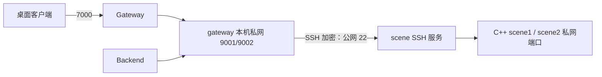

# 两台主机通过公网 SSH 隧道连接

适用于两台主机跨地域、现有内网链路带宽不足，但希望保留两台部署的 Demo。使用已经购买的公网带宽和流量，实际用量按现有云套餐计费。程序镜像仍使用 `transport-20261106-v1`，不需要重新构建。

## 为什么 ping 很低，游戏仍会等几秒

一次真实排查中，健康状态和 621 字节配置响应可以正常读取，但约 5.8KB 的游戏视图耗时 1.9～5.7 秒，超过 Gateway 的 2 秒 Scene 调用期限。双端 TCP 摘要确认数据包离开 Scene 后发生丢失和重传；把单包 MSS 缩小到 1200 仍未解决。主机 CPU、内存正常。

查询云实例元数据后确认主机位于不同地域，用户进一步确认云联网只使用免费测试带宽。腾讯云说明：预付费云联网未购买地域间带宽时，只有 10Kbps 以下测试带宽。10Kbps 约 1.25KB/s，5.8KB 响应的理想传输时间就约 4.7 秒；小 ping 成功不能代替真实视图验收。[腾讯云配置带宽说明](https://cloud.tencent.com/document/product/877/49859)

本方案让流量走公网 SSH 加密连接。Gateway/Backend 容器先连接 gateway 本机的私网转发端口，SSH 再连接 scene 的公网 SSH 入口，最终从 scene 本机访问场景端口。Scene 的 9001/9002 继续绑定私网地址；玩家仍连接原来的 Gateway 7000。



## 已部署服务与配置

gateway 主机使用 `mmo-scene-tunnel.service` 管理长连接，开机启动，异常退出后重连。Scene 服务与数据库不需要搬迁。模板见 [systemd 服务](../deploy/mmo-scene-tunnel.service.example) 和[地址配置](../deploy/scene-tunnel.env.example)；模板地址需要替换为实际地址。

gateway 的文件：

| 文件 | 用途 |
| --- | --- |
| `/etc/mmo-scene-tunnel/tunnel.env` | gateway 绑定地址、scene 公网及私网地址 |
| `/etc/mmo-scene-tunnel/id_ed25519` | gateway 本机生成的专用转发私钥，权限 600，目录 700 |
| `/etc/mmo-scene-tunnel/known_hosts` | 经现有可信 SSH 连接取得的 scene 主机公钥，启用严格校验 |
| `/etc/systemd/system/mmo-scene-tunnel.service` | systemd 管理的 SSH 进程 |

scene 的 `/root/.ssh/authorized_keys` 追加专用公钥，限定来源为 gateway 公网地址、限制本地转发目标到两个场景端口，并用强制命令禁止交互 shell。私钥只留在 gateway；没有把 Windows 的个人私钥复制到 VPS。未修改全局 sshd 登录策略。[OpenSSH 密钥限制说明](https://man.openbsd.org/sshd.8#AUTHORIZED_KEYS_FILE_FORMAT)

`deploy/gateway-host.env` 的 `SCENE_HOST_IP` 改成 **gateway 本机实际私网 IPv4**，对应隧道的 `TUNNEL_BIND_IP`。`deploy/scene-host.env` 的 `SCENE_BIND_IP` 继续是 scene 自己的私网地址。MySQL、内部密钥、镜像标签、命名卷和数值配置继续使用原值。

## 日常检查

在 gateway 主机：

```bash
sudo systemctl is-active mmo-scene-tunnel.service
sudo systemctl is-enabled mmo-scene-tunnel.service
sudo systemctl status mmo-scene-tunnel.service --no-pager
sudo journalctl -u mmo-scene-tunnel.service --since '10 minutes ago' --no-pager
```

检查游戏容器和内部读取，按[连接排错](CONNECTION_TROUBLESHOOTING.md)的容器探测命令操作。该命令从 Backend 当前配置读取目标地址，走切换后的隧道。

```bash
cd ~/mmo-server
sudo docker compose --env-file deploy/gateway-host.env -f deploy/gateway-host.compose.yaml ps
curl --fail --max-time 5 http://127.0.0.1:8080/readyz
```

地址变更时更新 `/etc/mmo-scene-tunnel/tunnel.env`，再重启隧道；公网地址变化还需要核对主机公钥绑定，以及 scene 授权公钥的来源地址限制。

```bash
sudo systemctl restart mmo-scene-tunnel.service
```

修改 gateway 的 `SCENE_HOST_IP` 后，按原有维护顺序停止 Gateway、停止 Backend，再重建两个容器；单独重启 SSH 隧道不会更新容器环境变量。重启隧道会短暂中断正在进行的内部调用。

## 回退与边界

原 env、Compose、MySQL 快照和 scene 的原授权文件保存在两台仓库的 `backups/` 私有目录。回退游戏路由时，先停止 Gateway/Backend，恢复本次备份的 gateway env，再启动；确认已切回原路由后停止隧道。恢复原免费云联网路径仍会遇到原带宽限制。

后续扩大在线人数时，优先评估同地域部署或具有足够带宽的专用内网连接；隧道不等于容量扩容。它仍受公网质量、套餐带宽/流量、SSH 进程和两端主机可用性影响。部署验收应读取完整游戏视图，并用客户端验证移动和技能，不能只看 `healthy` 或 ping。
